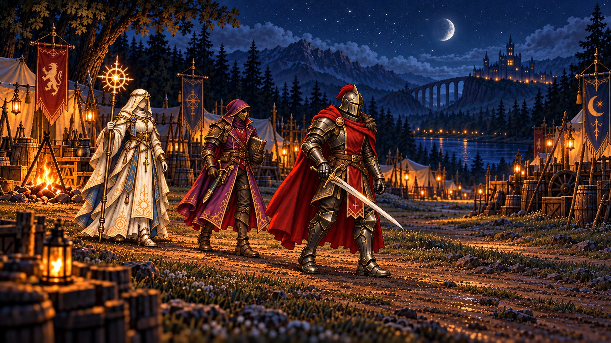
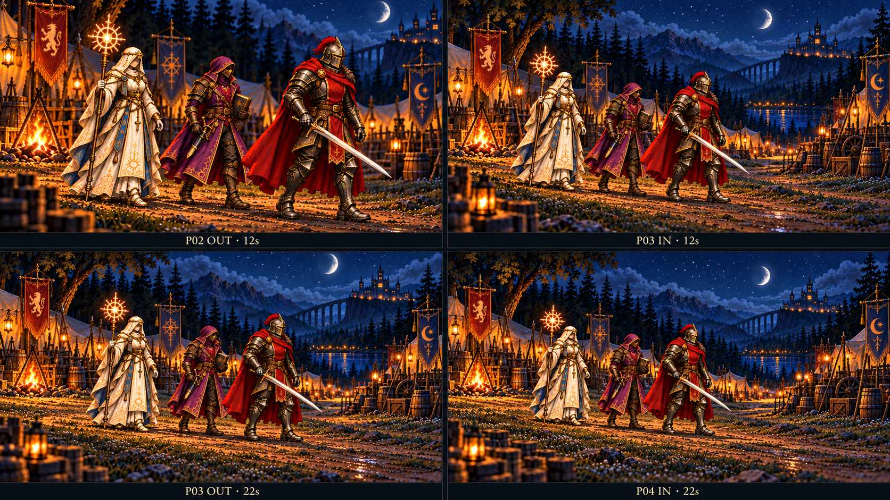

# P03 — images fixes filmiques et poses de coupe proposées

> **Suite manuelle v3 :** [pose d'appui corrigée](../../tools/cinematics/candidates/manual-p03-20261020/p03-support-v3.png), [arrêt proposé](../../tools/cinematics/candidates/manual-p03-20261020/p03-stop-v1.png) et [comparateur à source commune par coupe](../../tools/cinematics/candidates/manual-p03-20261020/review-support-v3.html) maintenant disponibles. Voir la revue complémentaire en fin de document. Les v1/v2 et la planche initiale ci-dessous restent conservées avec leurs limites.

20octobre2026 ; run `codex-manual-p03-stills-20261020`, baseline `dev@420fb34a6e79c98a0d48c7f654ccdfe087959bf3`. [Autorisation interactive](MANUAL_CAMP_P03_STILLS_OPERATOR_DECISION_2026-10-20.md) : l'opérateur dit « go » à la prochaine étape manuelle keyframe P03/raccords P02/P04. Imagegen intégré utilisé, trois appels : keyframe v1, correction ciblée v2, planche de quatre poses. Aucun appel MiniMax, génération/polling vidéo ou nouveau job QA.

## Livrables pour revue

**Keyframe d'entrée proposé v2 :** [PNG1672×941](../../tools/cinematics/candidates/manual-p03-20261020/p03-entry-v2.png).

**Planche proposée :** [P02 OUT / P03 IN / P03 OUT / P04 IN](../../tools/cinematics/candidates/manual-p03-20261020/p03-cut-poses-v1.png). Chaque vignette offre une définition plus basse que le keyframe séparé ; la planche est une étude de poses et tailles de plans, pas quatre frames issues d'un rendu continu.

La [v1 conservée](../../tools/cinematics/candidates/manual-p03-20261020/p03-entry-v1.png) plaçait les pieds trop bas et le groupe trop en ligne. La correction v2 recule le cadre et espace davantage la profondeur. Les [prompts et provenances](../../tools/cinematics/candidates/manual-p03-20261020/provenance.json) sont conservés, y compris le prompt initial et sa correction. Aucun asset du jeu n'est écrasé ou adopté.

## Revue visuelle de cette livraison

| Point | Observation / disposition |
| --- | --- |
| Identités V2 | Voile ivoire/or/bleu de Marian, capuche/violet/or et livre de Maelor, casque fermé/armure sombre et cape rouge d'Alistair reconnaissables. Aucun nouveau personnage ou visage exposé. Fidélité artistique finale opérateur, pas d'acceptation inférée. |
| Mains / objets | Livre fermé côté anatomique gauche de Maelor ; bâton côté droit de Marian ; épée côté droit d'Alistair, dague attachée de Maelor. Les trois objets principaux restent présents dans les quatre vignettes. Les détails de fermoir/doigts ne sont pas certifiés identiques à cette résolution. |
| Lame | v1/v2 la relèvent nettement au-dessus de la terre. Sa projection passe encore devant la silhouette des jambes ; l'enveloppe de séparation réelle lame/jambes/cape reste à résoudre et à observer dans le pilote. Aucun nouveau fourreau. |
| Cadre v2 | Corps entiers, six chaussures discernables, sommet du bâton dans le cadre ; pieds d'Alistair visuellement vers80% de hauteur, zone de terre dégagée en bas. Lecture plus exploitable que v1. Mesure visuelle indicative, aucun verdict de bounds runtime/portrait. |
| Angle / jeu | Trois-quarts modéré et décalage de profondeur proposés, mais attitudes encore proches de poses de présentation. La libération d'un talon et la charge du bassin ne sont pas assez manifestes pour prétendre certifier la partition physique. À juger/corriger avant un rendu de marche. |
| Bâton / robe | Chaussures de Marian partiellement dégagées naturellement ; pointe du bâton visuellement au sol ou très proche. Lever le bâton avant son déplacement reste une exigence du pilote, pas un mouvement prouvé dans cette image. |
| Camp | Même famille nocturne, feu à gauche, tentes/bannières, rivière/aqueduc/château/croissant. Cadrage interne avant dialogue, aucun seuil franchi. Perspective nouvelle proposée ; aucune implantation3D ou géométrie canonique n'est prouvée par ces images. |
| Planche des coupes | Ordre des acteurs, côté d'axe et grandes familles d'objets conservés. Les cadrages, distances entre acteurs et détails de terrain varient ; les appuis ne sont pas appariés exactement sur les mêmes repères. P02 est très serré en bas. **Étude seulement, raccords non validés.** |
| Mouvement / dramaturgie | **NOT_RUN** : trois PNG n'établissent ni marche, cycles, durée, poids en mouvement ou arrêt sans glissement. Aucun G2/animatique ou rendu filmé accepté. |

**Verdict : DELIVERED_FOR_OPERATOR_ART_REVIEW_WITH_LIMITS.** Le v2 est proposé pour cadrage/identités ; la planche sert à discuter les coupes. Aucune image n'est promue comme keyframe approuvé ou source vidéo prête. La v1 et la planche ne sont pas effacées pour masquer les limites. Pas de troisième itération du keyframe sans nouveau choix ou observation ; il faut changer une hypothèse précise plutôt que multiplier les poses rigides.

## Une prochaine action

**Revue artistique opérateur du keyframe v2 et de la planche : juger le cadrage/l'angle et désigner la correction de pose d'appui nécessaire avant de figer les raccords.** La production d'un pilote vidéo continu reste une étape manuelle distincte ; pas d'appel implicite MiniMax, pas d'extension de la série04, pas de remplacement MP4 ou d'activation audio.

## Préservation et conformité

Set1.7.0, baseline immuable `f4aae63e792025430c16153e1cd329c20745cf6b`. Constitution, index/manifeste, WORLD_AND_CHARACTERS, PRESENTATION_AND_MEDIA, AUTHORING_AND_QA, AUTONOMOUS_WORK_PROTOCOL, décisions, dossier et compagnon rapproché lus. Aucun contrat LOCKED modifié. Exactement huit slots ; durée camp livrée12s, propositions10s/28s inchangées. Les339jobs/acceptations, candidats01–04, blocs Bois-Clair, V6 et audio sont préservés. Aucun changement runtime, campagne/RunSystem/combat, économie, canon, scheduler ou source/public. Pas de jeu joué, d'acceptation globale PC, d'équilibre, d'art ou de mobile.

| Ligne | Verdict de cette étape |
| --- | --- |
| GAME_CONSTITUTION | PASS préservation — aucune nouvelle vérité. |
| ART_DIRECTION | PASS périmètre manuel ; qualité et intégration non acceptées. |
| CHARACTERS | PASS références préservées ; continuité détaillée future ouverte. |
| ENVIRONMENTS | PASS famille conservée ; nouvelle perspective proposée. |
| NARRATIVE / CAMPAIGN | PASS pré-dialogue intérieur ; aucun événement ajouté. |
| NARRATIVE_PRESENTATION | PASS huit slots/propriétaires inchangés. |
| TRAVERSAL | N/A — retiré. |
| COMBAT | N/A — inchangé. |
| SAVE | PASS — aucun changement V6/source. |
| UI / ACCESSIBILITY | N/A runtime ; cadrage proposé, portrait non accepté. |
| QA_EVIDENCE | PASS limites explicites — aucune preuve de locomotion revendiquée. |
| REPOSITORY_GOVERNANCE | PASS — verrou manuel, payload candidat versionné, publication normale dev OD-2026-10-12-A. |

Les contrôles documentaires/SHA/LOCKED/validator et la clôture sont consignés au [handoff](handoffs/2026-10-20T1905Z-codex-p03-stills.md). Tests source/types/build/browser produit non requis pour ces candidats hors runtime ; aucune ancienne recette n'est relancée. Images générées avec l'outil intégré, aucun fallback CLI/API ni clé lue.

## Suite « go » — correction d'appui et méthode de raccord

Run `codex-manual-p03-support-20261020`, baseline `eb0a5858752397c570d42c5baa7610df98e7500a`. L'opérateur demande de poursuivre la revue des angles/appuis/raccords par « go ». Deux appels imagegen intégré, dans la suite manuelle d'images fixes : correction ciblée v3 depuis v2, puis pose d'arrêt proposée depuis v3. Anciennes images/prompts/provenance inchangés ; [provenance de cette suite](../../tools/cinematics/candidates/manual-p03-20261020/support-review-provenance.json).

**Constats sur v3 :** pied gauche d'Alistair visuellement posé à plat sous la charge, autre talon nettement levé avec avant-pied proche du sol ; attitude moins en parade et corps orienté davantage à droite. Le bâton de Marian est visiblement dégagé de la terre. La lame est portée à l'extérieur vers le premier plan gauche, hors des silhouettes de genoux ; sa projection reste proche de la cape, donc séparation physique dans le mouvement encore à observer. Livre fermé et mains principales reconnaissables, identités V2/nocturne/intérieur conservés. Le v3 est une pose de référence d'initiation, ciblée vers0,35s dans le prompt, pas la certification du photogramme exact de la coupe12s. Fixer cette phase commune lors du futur découpage.

**Arrêt proposé :** deux semelles visiblement revenues au sol par acteur, stance plus resserrée, bâton posé et livre retenu, lame hors des genoux. Le groupe est déplacé localement vers la droite et demeure à l'intérieur. La distance parcourue, la continuité des pierres et les transferts entre les deux images ne sont pas prouvés ; les images ne déterminent aucun fait d'expédition.

**Correction de méthode pour les coupes :** la planche initiale faisait générer quatre images indépendantes, ce qui changeait appuis, espacements et décor. Le comparateur reprend désormais une seule image pour P02 OUT/P03 IN et une seule autre pour P03 OUT/P04 IN. Fenêtres numériques respectives92%/96% et96%/100%, avec fenêtre P03 identique entre ses deux poses. Les semelles et les pierres sont ainsi exactement communes à l'intérieur de chaque paire d'affichage. C'est une **simulation numérique de cadrage**, pas deux points de vue filmiques ou une reconstitution3D ; elle ne valide ni parallaxe, ni géographie entre entrée/sortie, ni passage par deux cycles. Les repères A/B sont posés à la main à titre indicatif et ne sont pas des mesures calibrées.

Un seul contrôle du comparateur dans le navigateur : titre RPGThreeJS vérifié,4panneaux, sources communes par paire et fenêtres P03 égales, bouton pointeur/Espace avec aria-pressed cohérent,46px de hauteur, aucune erreur console ni débordement à1280×720 ; captures des deux rangées inspectées. Aucun scénario produit/campagne ni nouvelle matrice. Le premier serveur sandbox était inaccessible au navigateur ; relance du seul preview en hôte autorisé, HTTP200. Aucun défaut produit déduit. Le preview local5452/PID22960 est conservé pour revue, avec cinq fichiers accessibles seulement ; autres previews inchangés.

**Disposition :** correction visuelle d'image fixe livrée et comparateur exploitable ; **OPERATOR_ART_REVIEW_PENDING**, aucune acceptation G2, locomotion ou raccord filmé. Le « go » autorise cette suite, pas un verdict humain d'acceptation. Une prochaine action : **revue opérateur des deux poses et de leur phase de coupe commune pour sélectionner la base du futur pilote continu10s**. Ne pas lancer de vidéo, MiniMax, extension04, audio ou remplacement MP4 ; ne pas produire encore une variation sans nouveau défaut précis. Handoff de cette suite : [2026-10-20T1940Z](handoffs/2026-10-20T1940Z-codex-p03-support.md).
