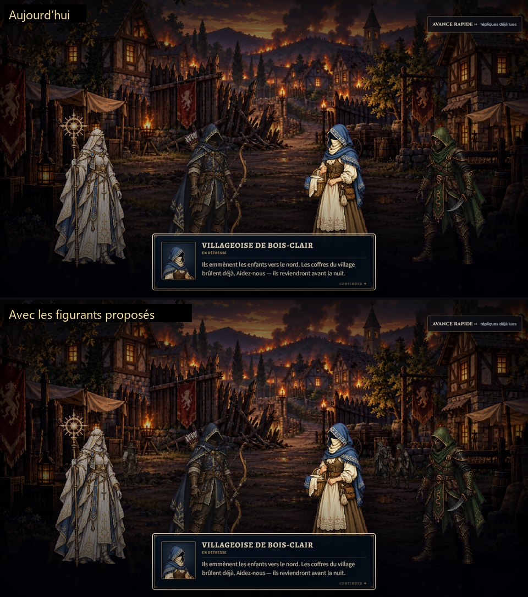
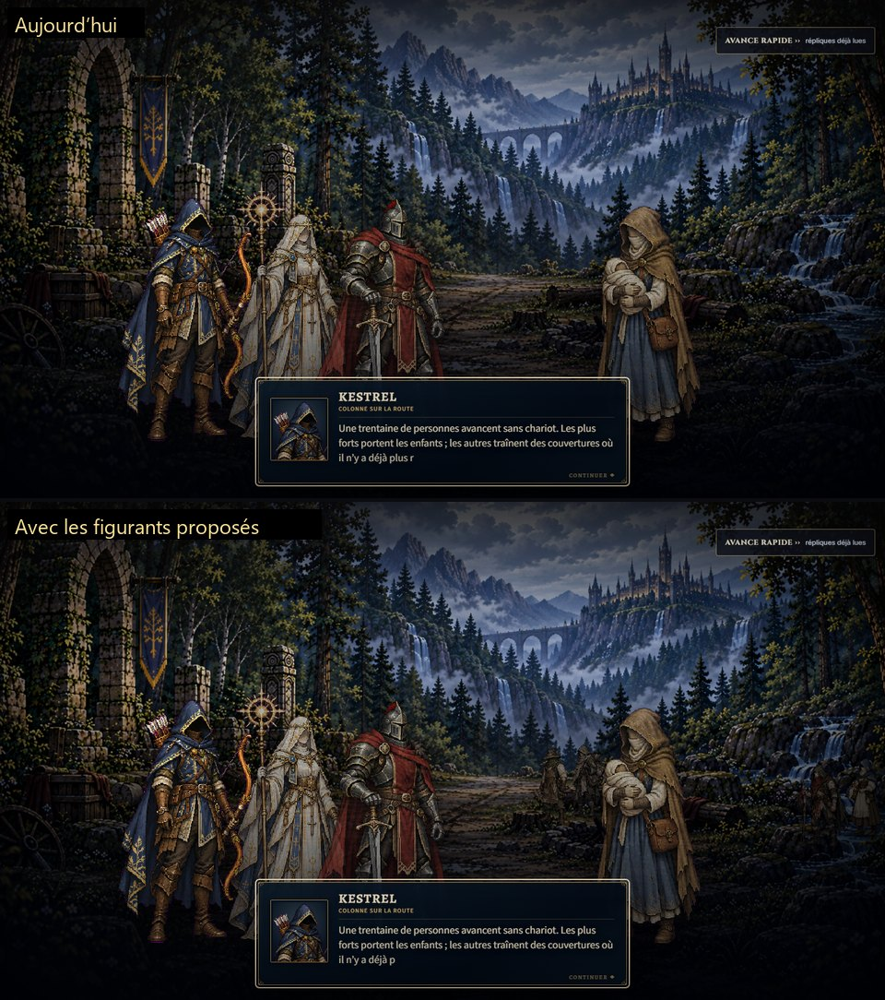
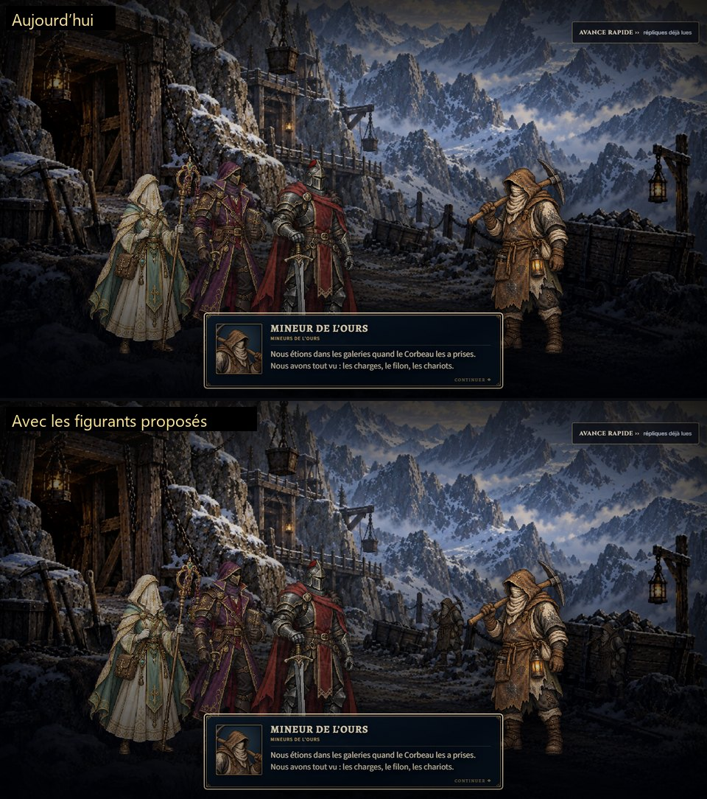
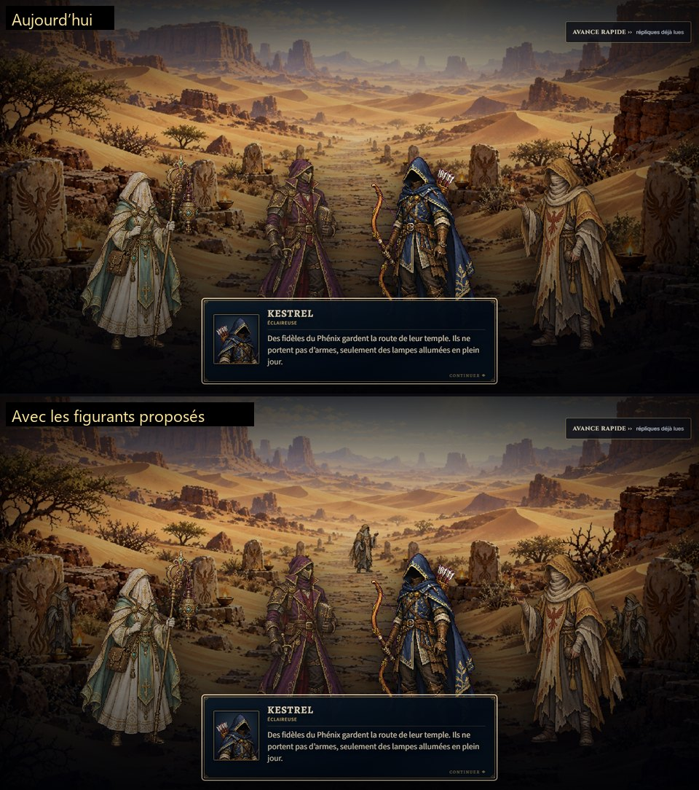

# Figurants muets dans les tableaux de dialogue ordinaires — brouillon d'amendement (2026-11-13)

Statut : `DRAFT`, soumis à l'opérateur. Rien n'entre dans les contrats ni dans le jeu avant sa validation mot à mot.

Origine : question E1 de la fiche de la dernière passe narrative (https://claude.ai/artifact/R9fw53FQzStpwffR6GdC1q). L'opérateur avait demandé d'« habiller nos événements avec les civils et personnages génériques ». À E1, il a choisi « Amendement, sprites existants » ([OD-2026-11-13-F](../../autonomy/COMPLETENESS_REVIEW_OPERATOR_DECISION_2026-11-13.md), section « Dernière passe narrative »).

Le problème :
- le jeu de contrats 1.23.0 n'admet des figurants que dans les tableaux vivants et leur décor animé (PRESENTATION_AND_MEDIA, puces « Cast » et « Animated backdrop ») ;
- un tableau de dialogue ordinaire ne montre que ceux qui parlent, quatre au plus ;
- il faut donc un amendement dédié : le jeu de contrats 1.24.0, tâche `PRODUCTION-CONTRACTS-TABLEAU-EXTRAS-1`.

## 1. Sprites civils existants et visages couverts

Seuls les maîtres civils déjà approuvés servent. Aucune image n'est générée, retouchée ni recolorée. Chaque maître est un carré de 512 px, les pieds sur la ligne 456.

| Partie | Sprite | Visage (OD-2026-11-11-G) |
| --- | --- | --- |
| Lion | `villageois` | couvert : chapeau à large bord et foulard vert jusqu'aux yeux |
| Lion | `villageoise` | couvert : voile et capuche bleue |
| Lion | `refugee` | couvert : capuche et voile |
| Lion | `refugee_mother` | couvert : capuche et voile ; le nourrisson est un lange sans traits |
| Lion | `survivor` | couvert : capuche, bandages et foulard rouge |
| Lion | `wounded_merchant` | couvert : chapeau et foulard (non utilisé ici) |
| Ours | `bear_miner` | couvert : capuche et tissu à poussière |
| Dragon | `dragon_villager` | couvert : capuche et écharpe de laine |
| Dragon | `dragon_pilgrim` | couvert : capuche profonde et voile |
| Scorpion | `phoenix_faithful` | couvert : capuche et voile |
| Scorpion | `phoenix_captive` | couvert : capuche et voile (non utilisé ici) |
| Acte final | `finale_citizen` | couvert : capuche et écharpe (non utilisé ici) |
| Acte final | `finale_civilian` | couvert : capuche profonde et écharpe (non utilisé ici) |

Vérification faite sur les seize maîtres civils, têtes agrandies au pixel près : aucun ne montre de traits.

Les trois miliciens du Lion (`village_militia_*`) sont écartés. Ils ont le visage couvert, mais ce ne sont pas des civils : dans l'histoire, ils se dressent contre la compagnie quand elle fait taire les témoins (`witness_road_clash`).

## 2. Les dialogues à habiller

Un dialogue est habillé seulement si ses propres répliques placent déjà des civils sur les lieux. Les figurants ne montrent aucun fait, aucun nombre ni aucune issue que le dialogue ne dit pas. Aucun texte ne change.

Dans l'Ours, le Dragon et le Scorpion, le seul sprite civil de la scène est celui du témoin qui parle. Les figurants reprennent ce sprite, en retrait : ce sont ses compagnons, que le texte nomme au pluriel (« Nous étions dans les galeries », « Le Loup nous retenait », « Nous avons fui le temple »).

| Partie | Dialogue | Ce que dit le texte | Figurants proposés |
| --- | --- | --- | --- |
| Lion | `refugee_trial` | « Une trentaine de personnes avancent sans chariot. » | un réfugié et un villageois qui passent sur la route ; un survivant et une villageoise arrêtés à droite |
| Lion | `village_choice` | la villageoise appelle à l'aide ; la séquence d'arrivée, déjà approuvée, montre le village | un villageois à gauche ; un réfugié et un survivant au fond à droite |
| Lion | `ate_village_fear` | « Des réfugiés sont revenus de la route. » | un survivant, un villageois, un réfugié |
| Lion | `rep_event_bois_clair_denunciation` | « Répondez devant ceux qui ont survécu à Bois-Clair. » | un villageois, une villageoise, un survivant, un réfugié |
| Lion | `rep_event_village_memorial_request` | « Nous graverons les noms ici, là où chacun connaît leur voix. » | une villageoise, un villageois |
| Lion | `ate_bois_clair_night_watch` | « Personne ne dort. Les survivants dressent des listes. » | un villageois, une mère réfugiée, un survivant |
| Lion | `village_defense_aftermath` | « Les enfants sont sains et saufs. » ; la séquence « Bois-Clair sauvé » montre déjà ces villageois | un villageois, une mère réfugiée, un réfugié, un survivant |
| Lion | `village_raid_aftermath` | « Les villageois… ils ne nous maudiront pas à voix haute. » ; la séquence « Bois-Clair sacrifié » montre déjà ces villageois | un villageois, un réfugié, un survivant |
| Lion | `witnesses_on_road` | « Les survivants ont dressé leur camp loin du nôtre. » | trois silhouettes lointaines près de la clôture : un villageois, un réfugié, une villageoise |
| Ours | `bear_miners_testimony` | « Nous étions dans les galeries quand le Corbeau les a prises. » | deux mineurs |
| Ours | `bear_mines_defense_aftermath` | « Les galeries sont à nous de nouveau ! » | trois mineurs |
| Dragon | `dragon_terrorized_village` | « Des portes barricadées, des enfants cachés dans les granges. » ; « Les villageois s'écartent devant elle. » | deux villageois |
| Dragon | `dragon_freed_pilgrims` | « Le Loup nous retenait au repaire pour porter ses vivres. » | deux pèlerins sur l'escalier |
| Scorpion | `scorpion_phoenix_faithful` | « Des fidèles du Phénix gardent la route de leur temple. » | trois fidèles, deux près des stèles à lampe, un au loin sur la route |
| Scorpion | `scorpion_temple_witnesses` | « Nous avons fui le temple pendant le combat. » | deux fidèles |

Soit 15 dialogues et 43 figurants, quatre au plus par tableau. C'est bien en dessous du plafond de douze. Les positions sont placées dans les vides entre les acteurs, mesurés à chaque réplique de chaque dialogue.

### Dialogues écartés, et pourquoi

| Dialogue | Raison |
| --- | --- |
| `bear_arrival` | « Ici personne ne nous attend. » |
| `bear_vigil`, `dragon_vigil`, `scorpion_vigil`, `finale_last_vigil` | la compagnie est seule : « Personne ne monte jusqu'ici », « Personne ne s'approche de notre feu » |
| `bear_trapped_miners` | les mineurs sont sous l'éboulement, et leur nombre est dit : « Nous sommes quatre ! » |
| `finale_trapped_citizens` | « Personne d'autre ne l'aurait fait » : des passants contrediraient la scène |
| `finale_arrival`, `finale_arena_chaos`, verdicts du Tournoi | la foule est déjà peinte dans les tribunes ; des civils sur le sable de l'arène seraient faux |
| `finale_capital_arrival`, `finale_allied_rally` | le texte ne place aucun civil : les démons tiennent les rues, et les bannières sont celles des clans |
| `first_refuge_gathering`, `ate_first_refuge_watch` | la scène du premier refuge est une décision ouverte de l'opérateur |
| `bear_outpost_gathering`, `scorpion_oasis_gathering`, `scorpion_scholars` | les gens nommés sont des guerriers de l'Ours ou des érudits du Scorpion, pas des civils : voir l'option B |
| `dragon_hermitage_gathering` | les gens nommés sont des moines, et aucun sprite de moine n'existe |
| camp et cour du Lion, `final_refuge` | des soldats du Lion, pas des civils ; au refuge final, « des familles attendent » derrière la compagnie, pas sur place |
| dialogues de route, de ruines, d'avant-combat et de repaire | lieux sauvages ou ennemis, sans civils dans le texte |

Ainsi, l'acte final n'a aucun dialogue habillé : ses civils sont peints dans les tribunes, ou la scène les dit absents. L'habiller demanderait d'écrire un fait nouveau.

La session de récit a laissé des pistes dans la section E de son brouillon (`HIGH_STAKES_NARRATIVE_PASS_DRAFT_2026-11-13.md`). Elles sont toutes reprises ou écartées ci-dessus, avec leur raison. Le rassemblement du camp du Lion n'a que des soldats du Lion. Les miliciens ont bien le visage couvert, vérifié en grand, mais ils restent écartés pour la raison donnée en section 1.

### Option B : les figures génériques que le texte nomme

L'opérateur avait parlé de « civils et personnages génériques ». La tâche s'en tient aux civils, comme son brief le demande. Mais trois scènes nomment des figures génériques du clan hôte, dont le sprite existe et a le visage couvert (vérifié en grand) :

| Dialogue | Ce que dit le texte | Figurants possibles |
| --- | --- | --- |
| `bear_outpost_gathering` | « Les guerriers de l'Ours ne nous quittent pas des yeux. » | deux ou trois `bear_warrior` (heaume fermé) |
| `scorpion_oasis_gathering` | « Une oasis tenue par les érudits du Scorpion. » | deux `scorpion_scholar` (capuche et voile) |
| `scorpion_scholars` | « Un camp d'érudits du Scorpion sur la piste du temple. » | deux `scorpion_scholar` en retrait de celui qui parle |

Si l'opérateur prend l'option B, seule la puce « Sprites » du texte d'amendement change :

> - **Sprites.** Only existing approved masters of the dialogue's own part, unchanged: its civilians (the Lion's villagers, refugees, survivor and wounded merchant, the Bear's miner, the Dragon's villager and pilgrim, the Scorpion's faithful and captive, and the final act's citizen and spectator) and, where the dialogue's lines name them, the generic members of its host clan (the Bear's warriors, the Scorpion's scholars). No generated or new image, variant, recolour or named character. Every reused master keeps a covered face (OD-2026-11-11-G).

Les phrases du `README` et du manifeste qui disent « civilian masters » deviennent alors « civilian masters and the generic clan members its lines name ».

## 3. Rendu proposé

- Un plan de figurants est posé sur la peinture, dans le calque du décor. Chaque figurant se tient donc sur le sol où il a été placé, quel que soit l'écran.
- Les figurants partagent le cadrage, l'étalonnage et la lente respiration du décor. Ils sont dessinés derrière tous les acteurs, un peu plus sombres qu'eux, avec une ombre au sol.
- Chaque figurant respire à son propre rythme. Les passants traversent lentement, avec un léger pas.
- En mouvement réduit, ceux qui se tiennent debout restent, immobiles, et les passants disparaissent.
- Un dialogue liste ses figurants pour la seule peinture où ils ont été placés. Sur toute autre image, aucun ne s'affiche.
- Les figurants n'ont pas d'identifiant d'acteur et ne reçoivent ni focus ni texte. Ils sont cachés aux lecteurs d'écran. Rien n'est sauvegardé.
- Si une image manque, sa place reste vide, sans délai pour le dialogue.
- Le décor animé d'un tableau vivant (lumière, feu, fumée) passe devant les figurants, comme dans la séquence qui précède.

## 4. Texte d'amendement, mot à mot

Le texte entre en anglais, comme le reste des contrats.

### `docs/contracts/PRESENTATION_AND_MEDIA.md`, nouvelle section après « Post-demo moments »

> ## Tableau extras — OD-2026-11-13-G
>
> Dedicated `PRODUCTION-CONTRACTS-TABLEAU-EXTRAS-1`, set 1.24.0. Ordinary dialogue tableaux may show silent extras as moving scenery, in the dialogues that the operator approves by id, under the cast rule of the living tableaux.
> - **Cast.** At most four visible narrative actors, unchanged. Extras have no line, name, role, focus or facing relation, are drawn behind the narrative actors, number at most twelve in one tableau, and are never counted as actors or fed to the relational staging planner. Text, choices, focus, facing and the speaker's portrait are unchanged.
> - **Sprites.** Only the existing approved civilian masters of the dialogue's own part, unchanged: the Lion's villagers, refugees, survivor and wounded merchant, the Bear's miner, the Dragon's villager and pilgrim, the Scorpion's faithful and captive, and the final act's citizen and spectator. No generated or new image, variant, recolour or combatant. Every reused master keeps a covered face (OD-2026-11-11-G).
> - **Canon.** An extra shows only people whom the dialogue's own lines, or its approved preceding sequence, already place on the spot. It shows no fact, count, outcome or consequence that the dialogue does not state. No dialogue that keeps a place empty or counts its people is dressed. A dialogue is dressed only once the operator approves its id and its extras.
> - **Truth.** Extras carry no game truth: they read no route, choice, reputation, relation, resource or outcome, and create none. They come from a presentation-side table keyed by the authored dialogue id and by the painting they were placed on; over any other picture, none show. They are never saved, and nothing transient is serialized.
> - **Motion.** An extra stands and breathes, or passes slowly. Reduced motion keeps those who stand, still, and removes those who pass. A missing image leaves its place empty and never delays the dialogue.
> - **Unchanged.** Dialogue text, staging, the four-actor cap, the living tableaux and their backdrops, zero video and every other rule.

### `docs/contracts/AUTHORING_AND_QA.md`, nouveau paragraphe après « Plateau music evidence »

> ## Tableau extras evidence — OD-2026-11-13-G
>
> Dedicated `PRODUCTION-CONTRACTS-TABLEAU-EXTRAS-1`, set 1.24.0. Required before acceptance: a focused test that every dressed dialogue exists, lists at most twelve extras drawn from its own part's civilian masters, and names the painting that its tableau shows; the four-actor test unchanged and green; a surface test that extras add no actor, focus or text and that reduced motion keeps only those who stand; types, the suite and a build; one browser check with a real gesture through several dressed dialogues of each dressed part, in normal and reduced motion. Operator artistic acceptance is by viewing.

### `docs/contracts/README.md`, en tête de l'historique des amendements

> Contract set **1.24.0** / `PRODUCTION-CONTRACTS-TABLEAU-EXTRAS-1` / [OD-2026-11-13-G](../autonomy/TABLEAU_EXTRAS_OPERATOR_DECISION_2026-11-13.md) lets the ordinary dialogue tableaux that the operator approves by id show silent extras under the living tableaux' cast rule: at most twelve, behind the four narrative actors, without line, focus, facing relation or planner input, drawn only from the existing civilian masters of the dialogue's part with covered faces, placed only where the dialogue's lines already put civilians, carrying no game truth and never saved (PRESENTATION_AND_MEDIA, AUTHORING_AND_QA). Constitution unchanged. Order: independent actual-diff review, operator approval, amendment commit, then a following operational commit that records its SHA as the immutable baseline before the game shows them.

### `docs/contracts/contracts.manifest.json`

`contractSetVersion` passe à `1.24.0`, avec une nouvelle entrée :
- `taskId` : `PRODUCTION-CONTRACTS-TABLEAU-EXTRAS-1` ;
- `operatorDecisionId` : `OD-2026-11-13-G` ;
- `changedContracts` : `AUTHORING_AND_QA`, `PRESENTATION_AND_MEDIA` ;
- `constitutionChanged` : `false` ;
- `supersededRule` : extras only in the code-animated living tableaux and their animated backdrops (sets 1.13.0, 1.14.0 and 1.20.0 "Cast"), the ordinary dialogue tableaux showing only their speakers ; ordinary dialogue tableaux approved by id may now show at most twelve silent extras behind the narrative actors, from the existing civilian masters of their part only, never carrying game truth and never saved ;
- `implementationAcceptance` : `PENDING; runtime, tests, browser check per dressed part and operator acceptance by viewing`.

La Constitution ne change pas.

## 5. Maquettes

Les captures sont rendues par le moteur du jeu, à 1440 × 810, sur le prototype de cette tâche, qui n'est pas encore dans le jeu. Chacune montre le tableau d'aujourd'hui en haut, et le même tableau avec les figurants proposés en bas.

- Lion, `village_choice` : 
- Lion, `refugee_trial` (deux passants sur la route) : 
- Ours, `bear_miners_testimony` : 
- Scorpion, `scorpion_phoenix_faithful` : 

Le texte de la villageoise sur la première maquette est encore l'ancien. La session de récit applique la retouche D2 à part.

## 6. Ce que l'opérateur valide

1. Le texte d'amendement de la section 4, mot à mot.
2. La liste de la section 2 : les 15 dialogues et leurs figurants, dont la reprise du sprite du témoin dans l'Ours, le Dragon et le Scorpion. L'acte final reste sans figurants.
3. L'option B : non par défaut, comme le brief. Avec l'option B, trois dialogues s'ajoutent et la puce « Sprites » prend la formulation de rechange.

Ensuite viennent la relecture indépendante du diff réel, le commit de la décision, le commit d'amendement, le commit de baseline, puis l'intégration au jeu et la vérification dans le navigateur.

## Validations de l'opérateur

À remplir à sa réponse.
