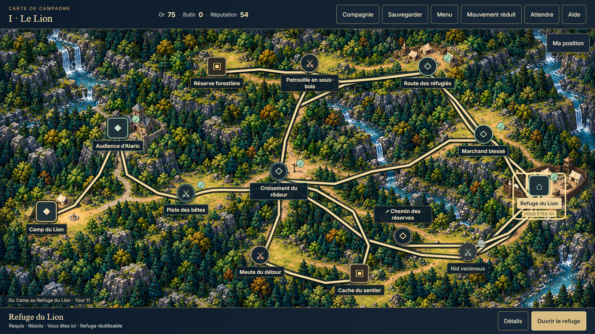
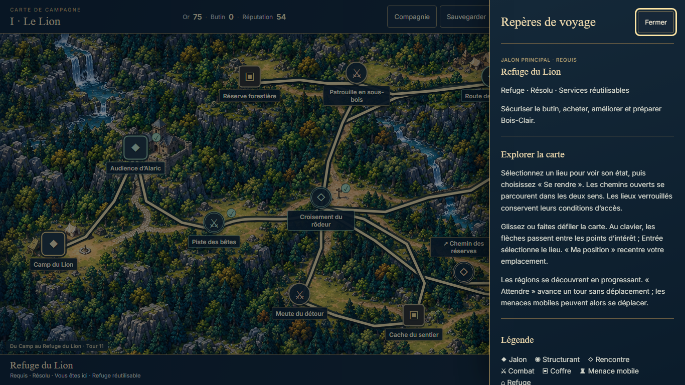
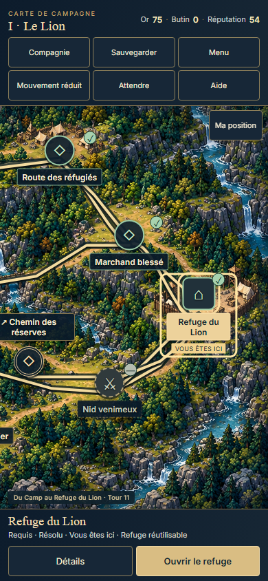

# Carte POI : espace, informations à la demande et déplacement

| Field | Meaning |
| --- | --- |
| TASK | POI-IMMERSIVE-MAP-UI |
| DOMAIN | UI / lifecycle presentation |
| BASELINE | dev@9e17edf7ba0cac143a5428ce9a849c71ca96cdd2 |
| BRANCH | dev |
| HEAD | Tested source36a4199325ca20f207509d9d23c102c5f44ae481; final closure is the containing Git commit |
| STATUS | COMPLETE_SCOPED; operator visual/global acceptance open |
| MERGED_IN | NONE; direct authorized dev checkpoint |
| SUPERSEDES | NONE; historical POI/Lot E evidence retains its scope |
| SUPERSEDED_BY | NONE |
| PRODUCTION_IMPACT | Compact POI chrome, optional information drawer, discovered-region tabs, larger proportional atlas, committed travel accent |
| CANONICAL_DOCS_UPDATED | docs/project/PC_PLAYTEST.md; paired autonomy state; dated handoff |
| EVIDENCE | Selected captures and scoped-proof.json below; raw immutable jobs under tmp/demo/poi-immersive-1903* |

## Operator finding and implemented behavior

Direct screenshot feedback on18October2026 requested fewer persistent explanations below the atlas, optional sidebar/help, no advance display of all three regions, the largest practical map with preserved POI integration, and fluid movement/living accents. This authorizes a presentation correction, not new campaign content or a gameplay rebalance.

The bottom dock now keeps the selected place, actual participation/status, available actions and locked-place explanation. Aide and Détails open a modal information drawer containing the selected context, instructions and legend. Escape/Close restore the opener; background map/actions are inert while open. Mobile threat position, next step, tendency, contested warning and eligible fight action remain visible outside the drawer. No duplicate fight control is hidden in it.

Only reached regions are shown, derived from current/resolved authoritative POIs. Prior regions remain consultable on backtracking. The initial region has no tab row; subsequent discovered tabs float over the map rather than consuming another full row. Roving keyboard navigation uses the discovered set.

The atlas fills the area between the compact header/action dock, with scroll/pan where its aspect ratio exceeds the viewport. Image, SVG paths and percentage POI anchors share the unchanged960:520 coordinate system. Marker targets remain at least44px. The first-region outbound label sits above its existing icon to avoid the demonstrated620px overlap; its coordinate and all other regions' label placement stay unchanged.

GameApp first obtains the RunSystem movement and saves it, then awaits a620ms presentation token along the existing rendered edge. Map intents are guarded/inert during this handoff. The token starts at the actual path origin, supports reverse paths and never writes state. Front interception leaves the position unchanged and shows no travel. Close/disposal, hidden document and OS/game reduction settle or skip animation. The guard releases on save failure and before downstream elite/content handoffs. Current-place glow, threat presence and drawer entry respect reduced motion. No animation is saved.

## Verification and limits

49current tests in PoiMapView, GameAppPoi, GameAppPoiExpedition and ReducedMotion pass; TypeScript and production build pass.23QA-helper tests pass on host; the initial sandbox helper attempt could not initialize temporary Git repositories and is infrastructure failure. Contract validator:8contracts/8video slots; immutable and working LOCKED gates empty; whitespace/syntax pass. Inherited Vite chunk-size advisory only.

The first native attempt FAILED on the unchanged visible-label-overlap assertion at620px. Root inspected the evidence and corrected the outbound label. The second FAILED because the harness measured the drawer during its finite200ms entry. One minimal harness correction waits for that animation to finish before the same bounds assertion. Neither failure is accepted or seedable; raw receipts remain unchanged. Both retries use the original certified2141earned save/proof, not failed intermediate saves.

Final `poi-immersive-1903-settled` is SUCCEEDED/exit0/errors[] with all six provenance/request/current-execution/digest eligibility checks true. Source36a4199, frozen build and actual driver/helper identities are recorded in [scoped proof](poi-immersive-map-2026-10-18/scoped-proof.json). Root inspected five captures; independent guardian review is recorded in the handoff/state.

Native first-refuge continuation exercised four real resolved moves: refuge→trial-event→crossroads→trial-event→refuge. Each observed moving token followed an owner/autosave position already committed, while map input was inert. Existing exact single-turn/no-replay/temporary-loot assertions and final earned V6 reload pass. Zero new battles; the one opening battle in the report is inherited2141evidence.

Same-page responsive inspection measured640/768px of map height on1366desktop,520.6/780px at620,584.6/844px at390. Optional drawer focus/Escape, bounds,44px controls, matching image/canvas geometry and no visible label overlap pass. Live OS/game motion toggles remove the current-place CSS animation and restore exact owner/save bytes. Source tests cover actual reduced-travel skip, reverse animation, cancellation and throwing-save cleanup. This is not native reduced-mode travel, new front interception/combat, three-region art, physical-device, spoken-AT, balance or global mobile/demo acceptance.

## Contract compliance

Set1.4.0, immutable baseline f9d8fde3f721fdf8da4b1e56a56bc51f20f2fef8. Constitution, index/manifest, AUTONOMOUS_WORK_PROTOCOL, UI_AND_ACCESSIBILITY, TRAVERSAL, CAMPAIGN_AND_STATE, PRESENTATION_AND_MEDIA and AUTHORING_AND_QA read; guardian also reviewed world/character boundaries. No LOCKED rule changed; both Git gates empty.

| Row | Result / evidence |
| --- | --- |
| GAME_CONSTITUTION | PASS — presentation subordinate to existing truth owners |
| ART_DIRECTION | PASS — existing atlases/palette; no remaster |
| CHARACTERS | N/A — unchanged |
| ENVIRONMENTS | PASS — proportional existing image/anchors |
| NARRATIVE / CAMPAIGN | PASS — original contents/choices and native no-replay movement |
| NARRATIVE_PRESENTATION | PASS — no new canon/media |
| TRAVERSAL | PASS — POI-only accent, no physical engine |
| COMBAT | PASS — elite handoff/rules unchanged; existing mechanical tests |
| SAVE | PASS — no schema/transient fields; save precedes motion; exact native reload |
| UI / ACCESSIBILITY | PASS_SCOPED — drawer/keyboard/responsive/motion checks above |
| QA_EVIDENCE | PASS_SCOPED — original seed, assertions, provenance, inspected captures; failures preserved |
| REPOSITORY_GOVERNANCE | PASS — one writer, explicit paths, normal dev publication; main protected |

321historical jobs and both deferred root objects remain JSON-equivalent;3new jobs retain distinct dispositions. Counts: runtime3, source tests2, existing QA2, helper tests1, promoted proof4, product guide1, workflow4; inherited WIP0. One initial native scenario, one source correction retry, one minimal harness correction retry. Scheduler, eight videos, canon, V6, economy, elites, art and audio scope unchanged. Global PC/art/balance/hardware verdict remains open; mobile deferred.
