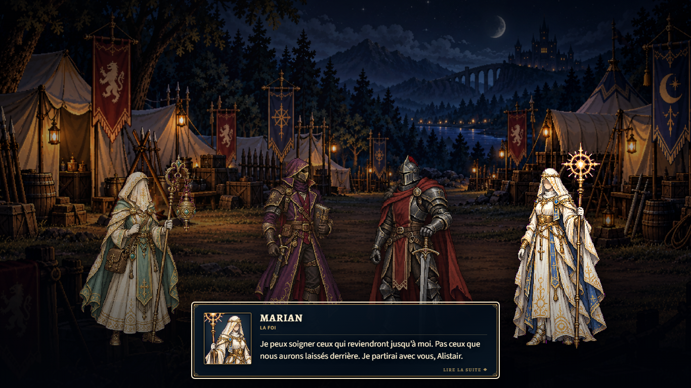
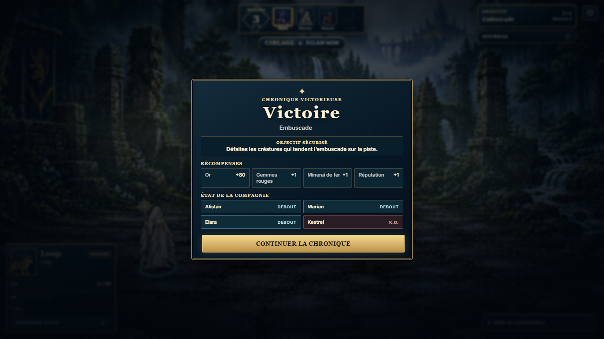
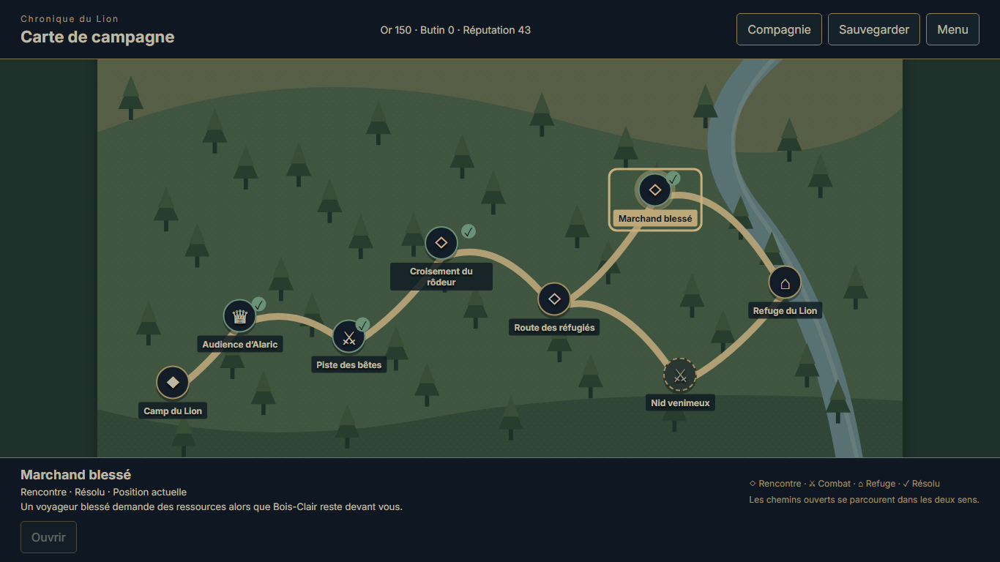
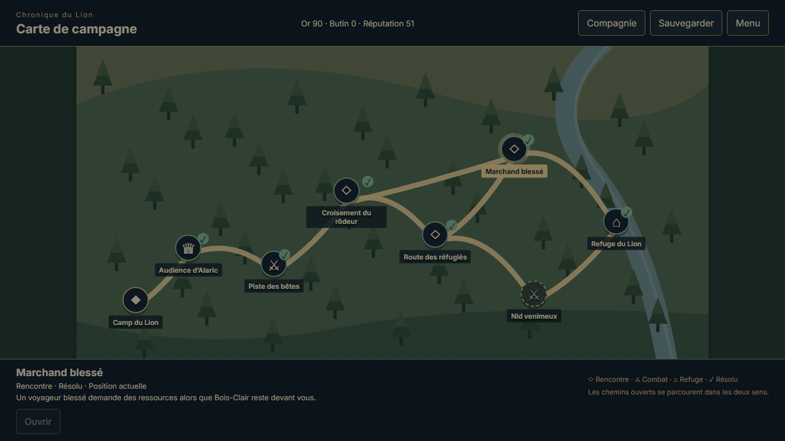
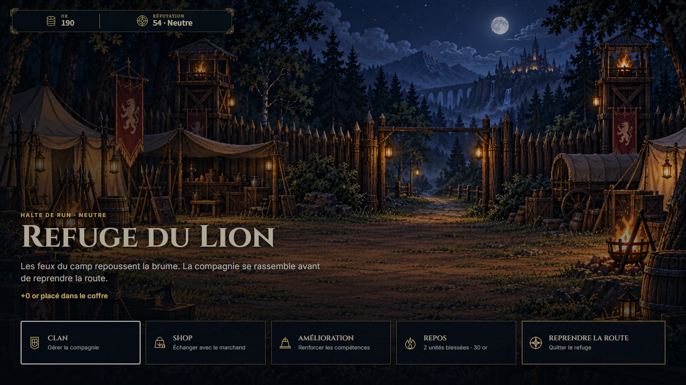

# Carte POI — première tranche jouable

| Field | Value |
| --- | --- |
| TASK | POI-MAP-FIRST-SLICE / PRODUCTION-CONTRACTS-POI-NAVIGATION-1 |
| DOMAIN | Campaign, run state, navigation, UI, V6 compatibility |
| BASELINE | dev @ c4c8a3a3dfe929c8ca55781e7250fe5b826570a2 |
| BRANCH | dev |
| HEAD | 5f3605d2c14e6b71965cf24f31deed6e0133c4c7, final executable/source-and-runner checkpoint; report publication is recorded by Git |
| STATUS | REVIEWED — ACCEPTED_SCOPED desktop first slice, published directly on dev |
| MERGED_IN | NONE — direct dev checkpoints |
| SUPERSEDES | NONE — historical evidence retained; navigation doctrine superseded by OD-2026-10-13-D |
| SUPERSEDED_BY | NONE |
| PRODUCTION_IMPACT | Connected POI navigation replaces playable Traversal in production; existing content owners execute the selected POI |
| CANONICAL_DOCS_UPDATED | docs/project/POI_NAVIGATION.md; operator decision/ledger, dedicated LOCKED amendment and operational gates |
| EVIDENCE | [Compact result and capture lineage](poi-map-first-slice-2026-10-13/results.json), five inspected captures; raw jobs remain in ignored tmp/demo |

**APPROVED DECISION.** OD-2026-10-13-D, set **1.2.0**, immutable amendment commit **692829f32d735ad890182eea6b5e5e195551bbbf**. The dedicated guardian review preceded integration. Operational baseline gates were then updated in **10ddd34**. Navigation alone supersedes the former physical-road doctrine; V6, canonical content, truth owners, Character V2, four visible actors, exactly eight videos and deferred audio remain protected. No LOCKED document changed during subsequent implementation.

**CURRENT FACT.** Product checkpoint **1449090** introduces `RunSystem` map selection and intent validation, `GameApp` handoffs, the geographical `LionPoiMap` layout and native `PoiMapView`/CSS. Correction **596e390** makes a legitimate optional bypass connection reversible from either endpoint and rejects invalid mandatory bypass facts. `poiContentAdapters` provides guarded future chest/elite seams: the production chest catalogue is empty, and no placement, amount, formation or lore was invented.

The playable route reaches **lion-first-refuge**, with the actual Alaric briefing, opening ambush, Cédric recruitment, optional refugee event and existing first trial. Navigation uses connected unlocked paths in both directions. A resolved POI opens no one-shot content; an excluded trial remains neutralized rather than falsely resolved. Ignoring refugees applies the existing −2 reputation consequence once, leaves them unresolved and permits a later real visit. Secured refuge services reopen without repeating arrival rewards. The map drives no invisible physical-road simulation.

The canonical directed graph and all 21 IDs are retained. Availability and stable adaptive assignments derive from existing run facts. No schema bump or serialized display state was introduced. Loading an unresolved old refuge arrival still enters its owner; completing it returns to the map. Canonical pending combats remain resumable. Old Traversal runtime/assets/drivers are retained pending full replacement and reference audit.

## Verification and provenance

`54/54` focused tests pass: `runSystem`35, POI navigation9, `GameAppPoi`6, retained route reward1, future content adapters3. The final nine navigation tests also passed after the invalid mandatory bypass guard. TypeScript, production build, contract validator (8 contracts/8 slots), exactly eight shipped MP4s, whitespace and empty immutable/working LOCKED gates pass. The inherited Vite chunk-size advisory remains. Unit fixtures seed resolution facts and verify authority handoffs; they do not prove played battles or authored chest placements.

| Native job | Actual proof | Provenance and limits |
| --- | --- | --- |
| poi-native-first-refuge-0057 | Fresh native opening, real forest_ambush victory in3rounds/17actions, Cédric, resolved backtracking, optional bypass/revisit, event choice with excluded combat neutralized, first refuge, reusable services and exact V6 reload | SUCCEEDED/stable, source dd18057, result61791ccf…; predates bypass-edge correction |
| poi-shortcut-native-0125 | Corrected bypass shortcut in both directions via mixed pointer/keyboard, no replay or changed consequences, real hub reopened and exact reload | SUCCEEDED/stable, final source9ba3d96d; result8642fda3…; inherits0057 battle, zero new combat |
| poi-legacy-map-native-0131 | Authentic pre-migration0603 V6 loaded; existing reputation choice pays210→190gold, flag and temporary loot checked; nine native return movements, no replay, real hub and exact V6 reload | SUCCEEDED/stable, final source9ba3d96d; result4bb53e8f…; inherits two0603 battles, zero new combat |

The old save/proof pair hashes are `d0fc5c11f8263316c071c4d859982f60a8be97b6d35ea024b7a960c93b5fd656` and `03eab0e5a83eea0f40c962cd7ce741df4e88cd4757ff331197f2f9f595bfc9f0`. Historical HP and acceptance are preserved. Native choices may create their existing consequences; exact invariance is asserted on resolved backtracking and passive refuge reopening, not on that paid choice. Complete receipt/input/build/driver/save hashes are in the compact result.

Failed/interrupted jobs remain non seedable and non accepted: `0037` waited for the map before driving the real post-refuge ATE; `0127` was stopped after the harness did not reopen a resolved current refuge; `0128` chose the existing refusal that starts a Serpent battle, outside the short continuation. `0124` proves old hub/reload only. No failed partial save was reused; no outcomes were injected or assertions weakened. Existing driver corrections handled native entry and authored choice differences. Automatic receipts remain separate from the orchestrator's recorded scoped acceptance.

All owned QA workers/previews terminated. Ports5407/5409/5411 were used. The initially inherited Vite29856 was left untouched and was absent at closeout. A separate local product preview was deliberately left available at http://127.0.0.1:5175/ (PID60640), serving the exact final dist/index.html, for the operator to play. No new QA runner, media generation or replacement was added.

## Independent compliance review

Guardian reviewed the dedicated amendment, actual owner/runner corrections, authenticated inputs, terminal receipts and selected captures. All rows PASS **within this scope**: GAME_CONSTITUTION, ART_DIRECTION preservation, CHARACTERS, ENVIRONMENTS selected captures, NARRATIVE/CAMPAIGN, NARRATIVE_PRESENTATION, TRAVERSAL/POI, COMBAT opening, SAVE fresh/legacy boundaries, UI/ACCESSIBILITY desktop1366 normal pointer/keyboard, QA_EVIDENCE and REPOSITORY_GOVERNANCE. Art finish, general balance and broader accessibility are excluded. Current set1.2.0 and baseline692829f gates are empty after implementation.

## Selected captures

## Remaining product work

First slice is accepted scoped; complete migration remains IN_PROGRESS. Next: earn the **second refuge** through POI navigation and existing Valmir/Bois-Clair content, with both canonical reputation/campaign consequences and exact V6 reload. Then verify former T2/T4 narrative continuations, later optional/exclusive branches and both endings. The first exclusive combat alternative is wired and mechanically tested but was not played afresh through the new map. Native defeat recovery, other legacy interruptions, mobile, reduced-motion/browser breadth and operator final demo acceptance remain open. Future chest/elite placements require actual approved content. Physical Traversal removal requires a complete reference audit after effective replacement, preserving historical evidence.

Counts:6 runtime source files,3 tests,1 existing QA driver modified,0 new QA tools,5 selected screenshots and1 compact result. Contract/operational/docs/handoff work is counted separately in the paired state. The owned WIP snapshot is incorporated into dev; scheduler remains PAUSED as observed, without reactivation.
