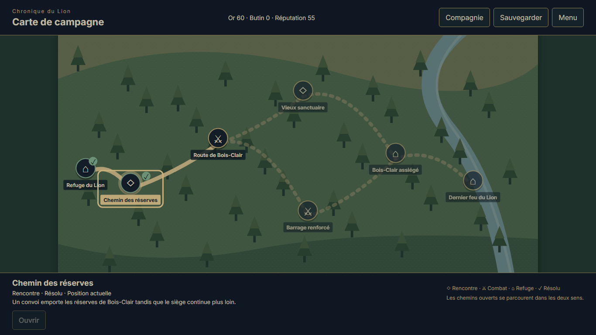
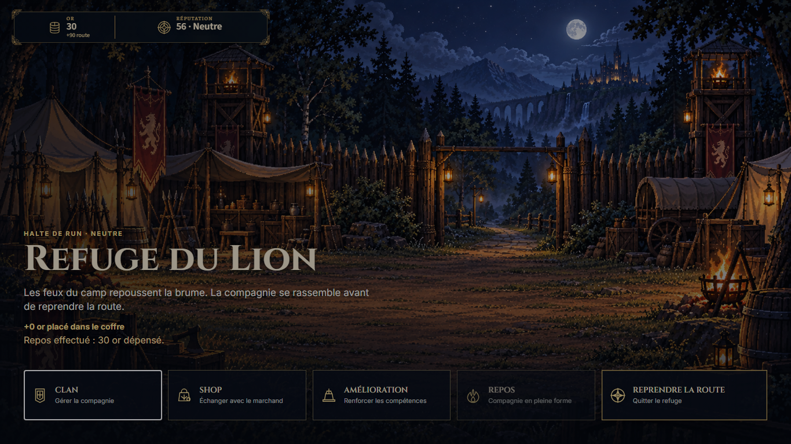
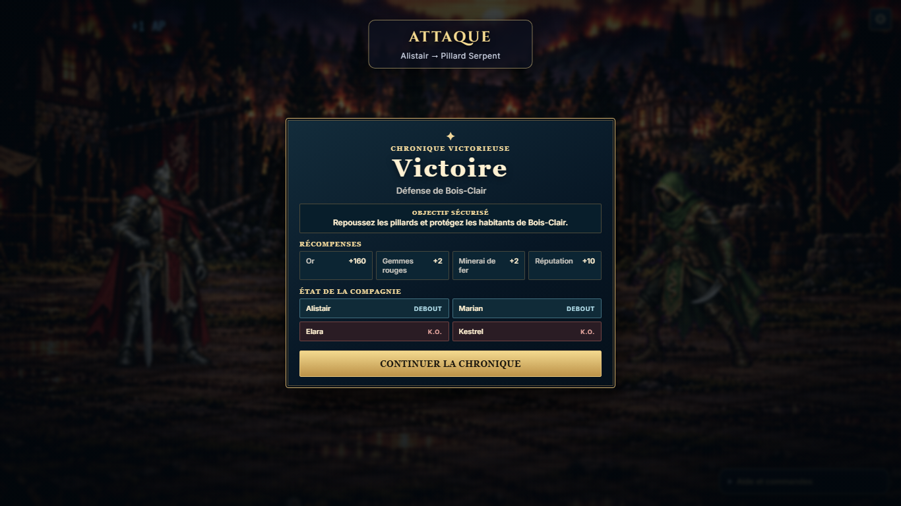
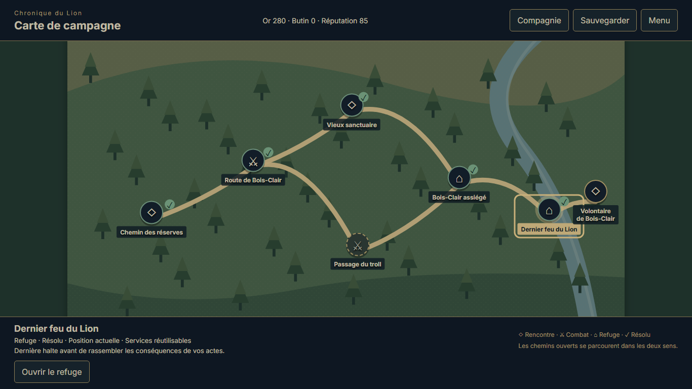
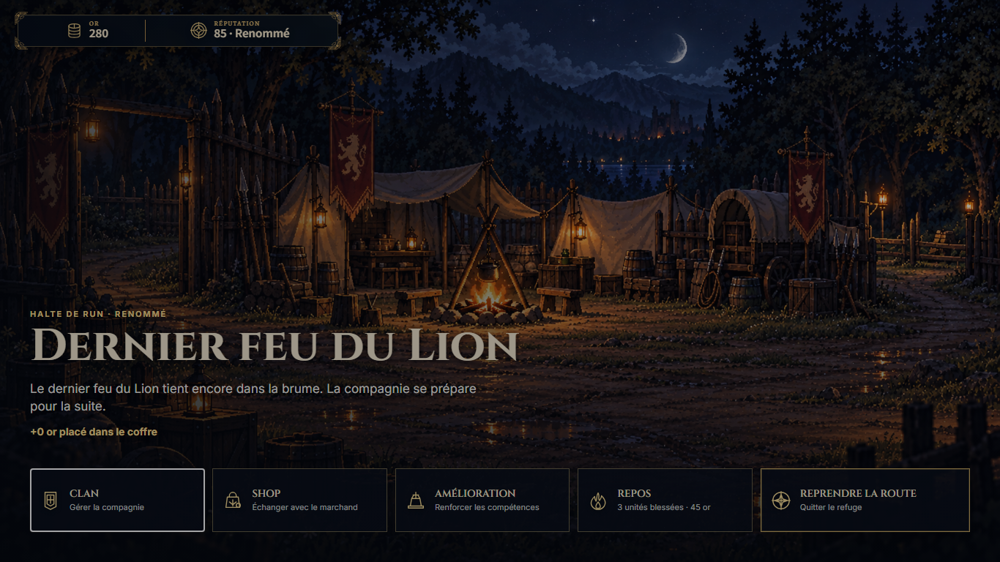

# Carte POI — intégration jusqu’au Second refuge

| Field | Value |
| --- | --- |
| TASK | POI-MAP-LION-CONTINUATION / POI-INTEGRATION-CLOSEOUT |
| DOMAIN | Campaign, navigation, combat handoffs, V6, UI, existing QA tooling |
| BASELINE | dev @ 41132a2868ba84835f8c58ab0d044dde24c03f32; first slice already published |
| BRANCH | dev |
| HEAD | 733737d2bc93c8556950df895f1f2aad9fba0b46 — final executable/source-and-runner checkpoint; closure publication identity follows Git |
| STATUS | REVIEWED — ACCEPTED_SCOPED desktop rescue through second refuge; documentation closure ready for publication |
| MERGED_IN | NONE — direct dev checkpoints |
| SUPERSEDES | NONE — extends the first-slice scope; historical evidence retained |
| SUPERSEDED_BY | NONE |
| PRODUCTION_IMPACT | Existing production POI map verified through second refuge; completed-chronicle Journey/title fallback corrected |
| CANONICAL_DOCS_UPDATED | docs/project/POI_NAVIGATION.md; docs/project/CURRENT_STATUS.md; docs/README.md; docs/autonomy/DEMO_COMPLETION_PLAN.md |
| EVIDENCE | [Compact reviewed result and selected capture lineage](poi-map-integration-2026-10-14/results.json); five inspected current captures; raw jobs/frozen originals retained in ignored tmp |

**APPROVED DECISION.** The operator requested finalization of this POI pass after its manual continuation, not further ending jobs. The dedicated contract amendment was completed first: **OD-2026-10-13-D / PRODUCTION-CONTRACTS-POI-NAVIGATION-1**, set **1.2.0**, immutable baseline **692829f32d735ad890182eea6b5e5e195551bbbf**. This closeout records implemented behavior and scoped acceptance; it introduces no further LOCKED rule or baseline change. Normal non-force `origin/dev` publication remains authorized by OD-2026-10-12-A. `main`, the scheduler and old unique WIP remain protected.

**CURRENT FACT.** The [first-slice report](poi-map-first-slice-2026-10-13.md) verifies Audience→First refuge, native opening victory, Cédric, optional bypass/revisit, exclusive neutralization, reversible map connections and authentic old V6 compatibility. This pass adds an earned native continuation through **reserves → Valmir → second-trial event → Bois-Clair rescue/defense → Second refuge**, using the production map and existing dialogue/tableau/tactical/refuge owners. No invisible road simulation, tactical replacement, new lore or invented reward was added. The map adapter displays all21 existing nodes across three geographical panels; later native gameplay remains unverified.

Product correction **f7ab12493481dfae768a19d9870bacd15f6d0b67** resolves a completed-chronicle dead end: a true completed ending with no pending finale resumes the existing terminal Journey; presentation failure returns to the title with Continue/New focus. Active campaigns and genuine pending finale combat retain their owners. Three mechanical regression cases cover these boundaries with exact save invariance. This correction does not establish native ending acceptance.

## Earned gameplay and exact consequences

| Native boundary | Observed result |
| --- | --- |
| First-refuge lineage | Authentic successful0057 save/proof, unchanged; initial opening victory inherited explicitly, never counted as a new battle |
| Valmir | Existing road_to_valmir tactical victory,5rounds/42native actions; raw Elara0HP becomes campaign1HP through the existing owner |
| Native preparation | Backtrack through resolved reserves to reusable First refuge; existing30gold rest, secured60→30, temporary loot90 unchanged, checkpoint unchanged, full party restored and exact autosave; return through reserves/Valmir without replay or reroll |
| Second trial | Existing old_shrine_event selected/resolved; T1 combat alternative neutralized and not falsely resolved |
| Bois-Clair | Authored rescue choices and actual village_defense victory,10rounds/50native actions; existing reward160gold/2red gems/2iron/10reputation; raw Elara/Kestrel0HP becomes campaign1HP |
| Mission/reputation | missionSuccess=true, missionGreed=false; authored reward refusal/memorial choice and existing reputation history preserved |
| Second refuge | Existing arrival/securing owner, checkpoint lion-second-refuge;280secured gold/85reputation/zero temporary loot; actual departure ATE completed before final map/save |
| Reuse and V6 | Both real refuge hubs reopened, no repeated securing bonus; exact saved bytes/owner reload; earned second-refuge save equals report.resumed |

Successful execution **poi-second-refuge-manual-0645**, `2026-10-14T06:44:49.522Z`→`07:26:18.759Z`, desktop **1366×768**, normal motion, rescue route. `SUCCEEDED`, exit0, stable provenance, native inputs, no fixture state, outcome injection, runtime mutation or browser errors. Result SHA256 **0f0f492ba2924e8102f34d12026d2303746aae760c76730d9b266d69d0d45868**. Earned V6 SHA256 **f0e6a039c4d3f5ec5dd36be0d349ef2cbb970a0fbd5e49a0343564fa97277c9a**; exact equality to `resumed` independently reviewed.

Execution source tree **4d7244c191ad9a58d53d9e74c24830cde40c3631**, head **733737d…**, driver **4927ac3de345ef1736fa13cb40907f726c2ce88ec5c2a12c97c0198fe4297d96**, receipt helper **2ca9771feffbdae4c296fd768771c0d988a9a6cab399cef4c54e27889994568c**, all nine production build inputs concordant. The original source/driver/helper/build/receipt/audit are frozen in `tmp/autonomy/poi-native-0645-original` before documentation edits. Raw execution receipts retain `NOT_ACCEPTED`; the reviewed scoped disposition is recorded separately in selected evidence and paired state.

The direct exceptional manual authorization **OD-2026-10-14-A** permits a120minute watchdog for this named run. Existing helper checks that exact authority/run at option parsing and actual registration/execution, with the owned lock; normal QA remains1–45minutes/default25. This case finished in about41.5minutes. Duration alone certifies nothing; gameplay, provenance, save equality and capture review establish this scope. Scheduler configuration was not changed.

Failed predecessors remain unchanged and unseedable: **0451**, **0540** timed out during actual village combat; **0643** failed before gameplay because the sandbox browser cache was missing. Neither timeout is a balance defect. Successful0645 used the already installed host browser cache, not a new installation. Failed originals and prior historical dispositions are retained. All225 pre-continuation jobs plus these four records remain in the229-job ledger, with original deferred skills/keyboard/narrative work preserved exactly.

## Verification and independent compliance

67 current focused tests pass: runSystem35, POI navigation9, GameAppPoi9, route reward1, adapters3, JourneyRunNodeAdapter10. QA continuity/authority helper18tests pass. TypeScript and production build pass; existing Vite large-chunk advisory remains. Contract validator8/8, eight approved video slots and eight shipped MP4s, empty immutable/working LOCKED gates and whitespace checks pass. Source/driver/build were frozen through0645 and remained unchanged during this documentation closeout.

Five broader JourneyCampaignBoundary failures reproduce exactly at pre-correction `e61b118` and remain open: two final-refuge title cases, departure eyebrow, post-Audience secondary actions and terminal label. The remaining13cases pass. This report makes no full-suite or full-campaign PASS claim.

| Guardian compliance row | Reviewed disposition |
| --- | --- |
| GAME_CONSTITUTION | PASS — existing truth owners |
| ART_DIRECTION | PASS preservation; overall finish excluded |
| CHARACTERS | PASS — Character V2 preserved |
| ENVIRONMENTS | PASS — selected current captures |
| NARRATIVE / CAMPAIGN | PASS — Audience→Second refuge, rescue scope |
| NARRATIVE_PRESENTATION | PASS — observed existing handoffs |
| TRAVERSAL / POI | PASS — native navigation of both sections |
| COMBAT | PASS — concerned native battles; general balance excluded |
| SAVE | PASS — native lineage, exact securing/reuse/reload |
| UI / ACCESSIBILITY | PASS — desktop1366 normal; broader matrix excluded |
| QA_EVIDENCE | PASS — actual sources/inputs and scoped review |
| REPOSITORY_GOVERNANCE | PASS — contracts/historical records preserved |

Guardian read constitution/eight contracts and relevant authorities, reviewed actual source/helper changes, final native lineage and five selected current captures. **No LOCKED rule changed in this continuation or closure.** The second-refuge pair is admissible for a future authentic continuation after current provenance/compatibility revalidation.

The browser/context/server close in the driver's `finally` before writing the terminal receipt, and exec returned exit0. A later independent PID7520/port5409 CIM check was **not executed**: automatic approval review could not complete because its reviewer quota was exhausted. Do not claim live process inspection or bypass that refusal. The separately retained product preview at http://127.0.0.1:5175/ remains available; operator browser storage was untouched. Publication/lock-release status follows the current paired state and handoff, rather than an inferred success.

## Selected current captures

## Scope closure and remaining migration

This POI pass is functionally complete and accepted **through Second refuge, rescue, desktop normal motion**. No ending job is launched at the operator's closure request. Native pre-judgement preparation, both endings/terminal/menu reload, other optional/exclusive routes, native POI defeat recovery, broader V6 interruption cases, OS reduced motion, mobile and final operator artistic/balance/demo testing remain open. Completed-chronicle correction is mechanically verified only. Bois-Clair night art remains an external presentation limit.

Old physical Traversal source/assets/drivers remain: shared `TRAVERSAL_RHYTHM` is still used in production timing, historical `traversalBranches` and named campaign relations retain durable POI meaning. Physical runtime removal needs full replacement verification and every reference inventoried; neither a folder name nor this scoped PASS authorizes blanket deletion. Production chest catalogue remains empty and any future placement needs approved content. No media generation, MP4 replacement or audio work occurred.

Continuation counts:1 runtime file,1 runtime test file,2 existing QA implementation files and1 existing QA test file modified;0 new QA tools;4 registered attempts (3 gameplay launches,1 pre-game environment failure);5 current inspected captures plus1 compact result promoted. Initial POI implementation/amendment counts remain in the first-slice report. Workflow/docs are counted separately in paired closeout state.
