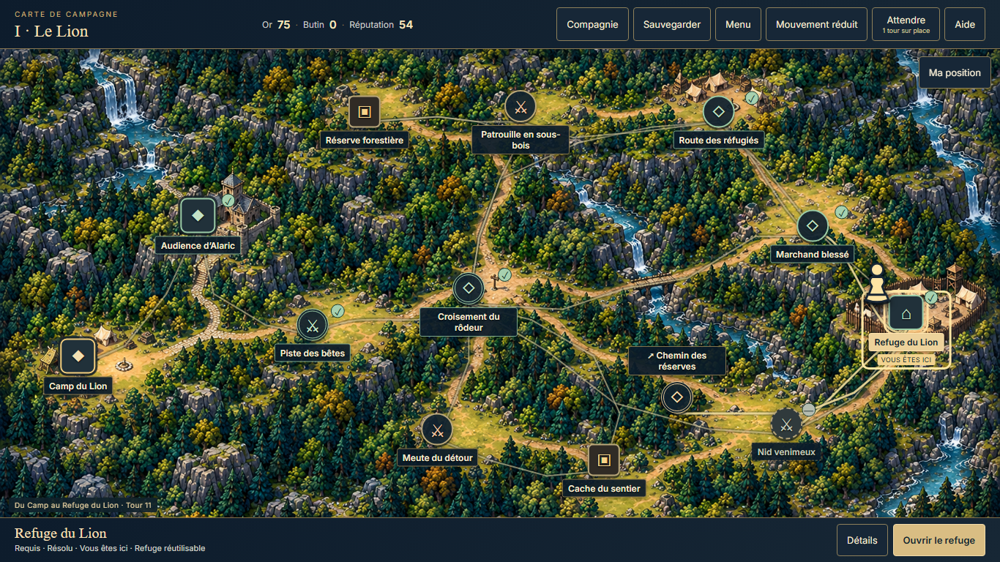
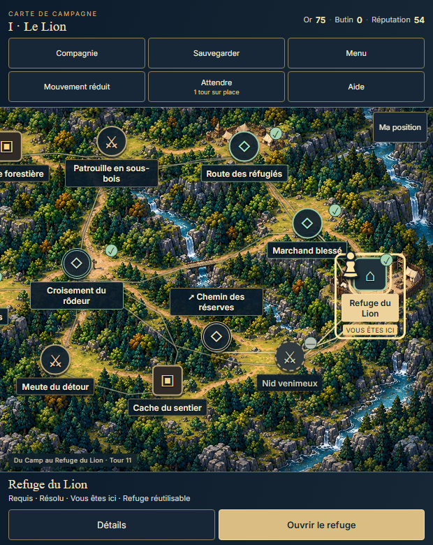
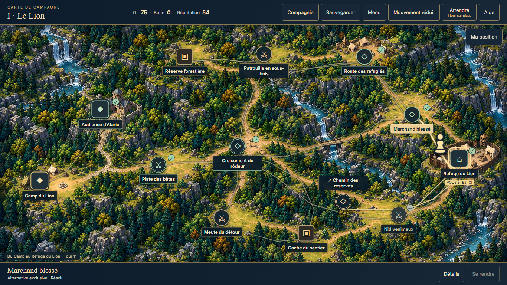

# POI paths, persistent player pawn and Wait clarity

| Field | Meaning |
| --- | --- |
| TASK | POI-PATH-PAWN-CLARITY |
| DOMAIN | UI presentation |
| BASELINE | dev@ee252d1b856b74dfd56d779fbfcf65031710e8b0 |
| BRANCH | dev |
| HEAD | Tested source4f044c4f74739134a256276edf46c889826c65cf; final closure is containing commit |
| STATUS | COMPLETE_SCOPED_UI; permanent-loot proposal awaits dedicated approval |
| MERGED_IN | NONE; direct authorized dev checkpoint |
| SUPERSEDES | NONE; earlier proofs retain original scope |
| SUPERSEDED_BY | NONE |
| PRODUCTION_IMPACT | Quieter paths with legal route emphasis; persistent animated pawn; visible Wait explanation |
| CANONICAL_DOCS_UPDATED | PC_PLAYTEST.md, paired autonomy state/handoff; separate PROPOSED loot task |
| EVIDENCE | poi-pawn-paths-2026-10-18/scoped-proof.json and selected captures; raw tmp/demo/poi-pawn-1935 |

## Operator request and delivery

Direct feedback18October2026: Wait's purpose unclear; provisional loot appears usable and should become permanent; connecting paths look tangled; a player pawn should remain visible and move progressively when confirming a destination.

Independent UI changes delivered: Wait visibly says1tour surplace, with accessible explanation that active threats may advance and help clarifying it does not heal. All existing connections remain, with thinner/quieter distant paths, clearer legal adjacent connections and one emphasized selected legal path. No connection, POI anchor or accessibility fact is created or removed.

An ivory/brass pawn sits beside the current POI, independently of the selected destination. It is noninteractive/aria-hidden while the existing current-POI accessible label remains authoritative. Browsing another earned region does not put a fake pawn at its exit. The same pawn follows the existing rendered path after owner commit/autosave, with gentle visual steps and bounded650–1100ms travel. Reverse, close/disposal, hidden-document and independent OS/game reduction retain the prior safe lifecycle. Completion leaves the pawn at the destination until the normal map/content handoff. No transient state is saved.

Current loot rules remain unchanged. Source review shows temporary-wallet purchases remain in temporary inventory, while equip/use/upgrade/forge/rest use permanent holdings. secureRunLoot also advances checkpointNodeId; calling it after each reward would wrongly change defeat recovery. The [concrete proposed dedicated task](../autonomy/POI_LOOT_PERMANENCE_PROPOSAL_2026-10-18.md) specifies immediate permanent gains, retention on defeat, unchanged amounts/costs/checkpoints, exactly-once remaining-pool conversion for old/current/terminal V6 and pending reward/shop handling. It is PROPOSED, not an approved amendment. UI work is independent of that decision.

## Verification

53current focused tests/4files PASS: PoiMapView19, GameAppPoi19, GameAppPoiExpedition11, ReducedMotion4. TypeScript/build,8contracts/8slots, syntax/whitespace and immutable/working LOCKED gates PASS. Unchanged helper23tests retained from prior checkpoint; no unnecessary rerun. Inherited Vite chunk-size advisory only.

One existing-runner scenario `poi-pawn-1935`, source4f044c4, certified original campaign-next-turn-2141 first-refuge save/proof, PC1366normal. SUCCEEDED/exit0/errors[]; all six registered provenance/request/current-execution/digest checks true. Four actual resolved movements refuge→trial-event→crossroads→trial-event→refuge verify selected path is exactly one real legal edge, selection leaves the resting pawn at the actual origin, moving pawn samples progress after owner/autosave commit, inert controls, one turn per move, no replay and exact final earned V6 reload. Zero new battles; inherited opening28actions remain historical.

Same-page1366/620/390 geometry/drawer/motion checks retained. Root inspected desktop,620idle and committed-travel captures: pawn is distinct beside the POI and does not cover labels; thinner connections preserve the painted roads. Final independent guardian review is recorded in handoff/live.poiPawn1935. Raw successful receipt remains NOT_ACCEPTED; reviewed scope is separate. No new native regionII/III, combat/interception, reduced-travel, realAT/device/global mobile/art/balance acceptance.

## Compliance and continuity

Contract set1.4.0, immutable f9d8fde3f721fdf8da4b1e56a56bc51f20f2fef8. Constitution/index/manifest and UI/TRAVERSAL/campaign/presentation/QA/autonomous contracts read; guardian also reviewed combat/loot boundaries. No LOCKED rule changed, protected gates empty. Permanence is a pending dedicated task, not implemented.

| Row | Result / evidence |
| --- | --- |
| GAME_CONSTITUTION | PASS — unchanged truth and temporary-loot rules |
| ART_DIRECTION | PASS — existing atlas/palette, code-native pawn |
| CHARACTERS | N/A — no character asset/canon |
| ENVIRONMENTS | PASS — original anchors/topology |
| NARRATIVE / CAMPAIGN | PASS — no-replay owner movement |
| NARRATIVE_PRESENTATION | PASS — original contents/handoffs |
| TRAVERSAL | PASS — POI presentation only |
| COMBAT | PASS — unchanged, no new battle claim |
| SAVE | PASS — exact native reload; no pawn serialization |
| UI / ACCESSIBILITY | PASS_SCOPED — focus, labels, bounds, pointer-free pawn and motion |
| QA_EVIDENCE | PASS_SCOPED — matched proof, inspected captures, no injected outcomes |
| REPOSITORY_GOVERNANCE | PASS — one writer, explicit paths, normal dev publication |

324historical QA jobs and deferredDemoTask/pendingNarrativeTask remain JSON-equivalent;325total. Counts runtime2/sourceTest1/existingQA1/newPersistentQA0/promotedProof4/productGuide1/workflow5(including permanence proposal)/inheritedWIP0/browser1/reusedReviewer1. Scheduler/preview5438 untouched. Review permanent-loot dedicated scope; independent authorized PC finishing stays available meanwhile.
