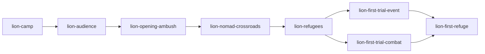
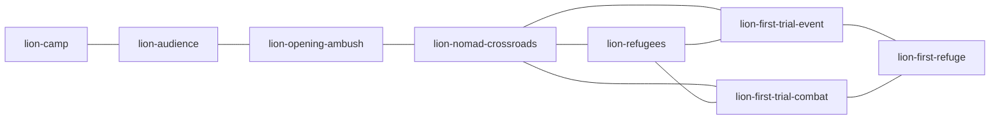

# POI V2 and physical-engine retirement

| Field | Value |
| --- | --- |
| TASK | POI-V2-AND-TRAVERSAL-RETIREMENT |
| DOMAIN | Campaign / UI / compatibility / retirement |
| BASELINE | dev@b79063bb4d96636198e93d61b7b3dd1110dab6e2 |
| BRANCH | dev |
| HEAD | See coherent delivery commits in Git; no self-reference |
| STATUS | COMPLETE_SCOPED |
| MERGED_IN | NONE; direct authorized dev checkpoints |
| SUPERSEDES | NONE; older scoped proofs remain historical |
| SUPERSEDED_BY | NONE |
| PRODUCTION_IMPACT | A real branches, B explicit roles/regions, C three illustrated atlases and D physical-engine removal delivered; recorded technical scopes accepted |
| CANONICAL_DOCS_UPDATED | Operator ledger, contract set1.3.0, POI_NAVIGATION, art/authoring and retirement inventory |
| EVIDENCE | A-results.json, results.json and nine selected captures in the adjacent task directory; native scopes, failed jobs and reuse limits below |

**CURRENT FACT.** All four lots are delivered with scoped technical acceptance. The final closure below consolidates results; intermediate pending statements remain as a journal of earlier checkpoints. Final operator artistic/hardware/full-balance acceptance remains separate.

## Approved decision and contract gate

OD-2026-10-15-A authorizes the exceptional manual mission. Both full operator attachments are preserved in docs/autonomy. Independent `contracts-guardian` actual-diff review PASS on2026-10-15: six changed contracts, README/manifest1.3.0; constitution, media and combat contracts unchanged. Corrections ensure map selection alone grants no completion and trial bypass cannot open first refuge. Validator8contracts/8slots and diff-check PASS. Amendment is a decision, not runtime acceptance. All twelve compliance rows PASS for amendment scope only; runtime, V6, art and retirement remain pending.

## First-phase topology

CURRENT FACT at starting HEAD: directed recovery graph:

The initial map adds crossroads→trial connections only after an explicit refugee bypass. V2 authorizes these as actual local geography once the mandatory crossroads is resolved, retaining the directed recovery graph:

Required facts: audience, actual opening victory, resolved nomad encounter, one actual exclusive trial. Refugee bypass is optional and once-only; skipped refugee remains revisitable. No new content IDs, chest, elite or reward placement is approved.

## Lot A implementation and first native finding

Product checkpoint `ca78057` published normally to origin/dev. RunSystem adds two authored local connections after all three mandatory corridor facts; all three outgoing contents are reachable at the crossroads. Direct trial selection applies the existing refugee-ignore consequence once through RunSystem. Required trials no longer expose bypass; actual resolution gates refuge. Old earned refuge flags/resolution preserve progression. Directed recovery graph,21IDs and V6 schema remain intact. Mechanical36current focused tests/types/build/contracts PASS; independent source/assertion review PASS.

Fresh native `poi-v2-first-refuge-0752` on5440: actual opening victory2rounds19actions and nomad dialogue, then **FAILED/NOT_ACCEPTED** at unchanged exact backtracking assertion. Result digest `fcfa4c03daa4b7e477c2e8920125687fcc7def6528539722f5d83acdd27bec5e`; provenance stable; no injection. Newly exposed unvisited trials initially received mandate-specific hints, but ID-only rematching replaced those hints on the next selector. Content IDs/resources/outcomes did not change; full saved-node stability still failed. The failed job is retained and unseedable.

Correction preserves a fully materialized graph node whose durable assignment already matches its content ID. Differing legacy assignments retain the existing restoration path. New full-graph mandate/backtracking/exactV6 regression plus57other focused tests pass; build PASS. Independent guardian correction review PASS. The native assertion is unchanged; fresh native rerun pending.

Fresh0810 **ACCEPTED_SCOPED_LOT_A_NATIVE_DESKTOP1366_NORMAL** on85b1889: actual opening victory3rounds17actions, authored Cédric choice, three reachable local routes, direct event selection, existing refugee37→35 once, trial initially unresolved then resolved, alternative neutralized/notresolved, refugee dialogue revisit, first-refuge services and exact full V6 reload. No errors/injection/mutation. Independent guardian verified raw result/receipt/9build files/driver/helper and three captures; all provenance/request/digest/current-execution checks passed before later source edits. Result SHA `b1819c257dbbb94bf486bac60fad2855473a841dc06be983b48155684bb43004`. [Selected compact proof](poi-v2-retirement-2026-10-15/A-results.json); the three `A-` captures preserve pre-art geography and reusable refuge. Failed0752 stays unseedable. This accepts A desktop normal only, not new art, alternate combat fresh play, B/D, mobile, motion or full demo.

## Lot B phase composition

Explicit metadata classifies all21canonical IDs by primary/structuring/secondary role, required/optional/exclusive-alternative participation and region. Depth no longer selects map panels. Opening is a forest network, Bois-Clair a river-valley fork and the final phase a diagonal ruin/preparation approach. Existing directed links, causal encounters, recruit/witness choices, rescue/sacrifice, refuges and final preparation/judgement remain unchanged. No new node/content/reward is activated. New metadata tests verify exact canonical coverage and independent region/eligibility boundaries; current25focused tests pass. C integrates the matching atlas artwork and richer marker hierarchy next.

## Lot C implementation

Checkpoint6d4e1f9 integrates three new pixel-diorama region illustrations, generated and inspected against existing environment references. Code owns all connections, roles, status and actions. Native region tabs, spatial marker keyboard navigation, Locate, background dragging and native touch scrolling support browsing without changing game truth. Failed movement restores focus; hovering never rebuilds the action panel. Artwork manifests retain exact provenance/hashes and the candidate status for final operator artistic review. No video, canonical sprite or shared environment was replaced. Inactive chest/encounter authoring proposals are documented separately and activate no unapproved content.

## Lot D source milestone

The physical simulation is removed: all87tracked src/traversal files, its scene/controller/preview branches, three labs,21dedicated physical runners, two styles and their obsolete tests. GameApp coordinates the sole POI facade and existing narrative, combat, refuge, preparation and terminal owners. RunSystem removes physical Pursuit requests/results while retaining durable T0–T4, V6 traversalBranches, recovery/bypass facts, adaptive encounters and loot/checkpoint authority. SceneTransition and the shared HUD remain neutral UI owners. The optional consequence policy was rehomed before the old shim was removed.

The reviewed177row inventory has zero uncertain dispositions and covers all144deleted paths.22orphan physical PNGs are removed; seven images linked by immutable historical reports and their metadata stay at original paths. Five obsolete mixed QA scripts are frozen as plain text; the UI gallery remains active with its original source archived. Shared characters, environments, cinematics, Journey, NarrativeStage, CombatBridge and compatibility APIs stay intact. No production importer, QA selector or active executable driver can mount the old engine.

Independent guardian actual-source/assertion review finds no authority/schema blocker.200relevant tests pass, six additional historical V6 lifecycle fixtures preserve the entire saved state and choose the proper current owner;23focused POI/refuge-order tests pass. All19QA receipt tests pass through node:test. TypeScript/build, eight shipped MP4s, validator8/8 and immutable/working LOCKED/whitespace gates pass. Broader159Vitest-compatible suites exposed historical source/media audit failures; exact classification follows in final verification. No global suite PASS or native retirement acceptance is claimed at this checkpoint. Existing campaign-driver assertions for real combat, consequences, defeat and exact V6 remain; the added atlas case uses native tabs/focus/44px targets/scroll and exact owner equality.

## Broader verification classification

The expanded discovery excluding ignored tmp snapshots ran2692Vitest cases:2681passed/11failed,151passing suites and nine nonpassing suites including the separately executed node:test helper. One stale source-order assertion was corrected to inspect the actual refuge branch rather than an earlier common guard; its seven cases and16GameApp POI cases then pass. The other ten failures are inherited findings: DialogueStagingDirector forest/tableau expectation; r6FullRouteIntegration old resume-predicate substring; historical character-scale audit; two retired-video polish checks; dynamic-gate sprite hash; finalization protected-file allowlist; three preproduction sprite/hash/allowlist checks. The relevant files/media are unchanged by this mission; guardian inspected the inherited source history, without claiming a fresh whole-baseline execution. The node:test helper has19independently passing cases and is not a Vitest suite. No media is restored or assertion weakened to manufacture a green global result.

Fresh narrative-staging validation passes282runtime-reachable presentation steps, with zero missing steps, speaker conflicts, placement regressions or normal dialogue scroll violations. Mechanical V6 interruption fixtures cover resolved route boundaries, unresolved event/fork and combat, genuine pending finale, neutralization/bypass, refuges and terminal agency. Fixtures are labelled mechanical; they are not played battles.

## Native review journal — staged checkpoints

The first D proofs below used frozen d104e21 source/build/driver/helper identities, actual native player inputs and verified earned save/proof pairs. Final presentation proofs use99ed9ed and final fresh proof eaae27f with the identical runtime source. Original raw receipts remain unchanged; review acceptance is separate. The following paragraphs preserve staged findings; consolidated disposition is in the final closure below.

| Current case | Reviewed scope |
| --- | --- |
| D-preparation-touch-os-1223 | Old earned Second-refuge V6→lancer/witnesses/final event/shadow signs/preparation; genuine390touch, OS-only/gamefalse, three regions and swipe570→371, exact V6, three actors/no hub/no securing. Preparation action42px found; corrected-build proof still required. |
| D-atlas-saved-game620-1226 | Three regions, keyboard focus and native scroll340→300, owner unchanged, loaded saved game reduction, reusable First refuge and exact V6. No new toggle claim. |
| D-defeat-touch-1229 | Actual new defeat3rounds/3native waits from accepted Valmir lineage. Saved temporary260→0, secured20→20; First checkpoint and entire expected=recovered=resumed V6. |
| D-terminal-serpent-1227 / D-terminal-trial-touch-1230 | Both genuinely earned old endings resume without replay; native desktop keyboard /390touch, terminal/menu/Continue focus and unchanged full owner/save bytes. All final battles are inherited, not newly fought. |
| D-legacy0603-1231 | Genuine pre-POI Traversal0603 save loaded after engine removal; existing authored departure cost/flag, native backtracking, reusable refuge and exact V6. Two old battles inherited; zero new combat. |

Failed D-preparation-touch-1221 loaded an already-game-reduced save into an OS-only case; failed D-atlas-game620-1224 ended its first-refuge continuation before reaching the pilot's native game-toggle step. Both whole outputs remain FAILED/NOT_ACCEPTED and unseedable. Later valid cases use separate original successful saves. Two desktop region captures also preceded image decoding; they cannot certify loaded artwork. Final atlas captures must wait for actual decoded images. The clipped bottom border label and42px preparation action are presentation corrections pending the end of frozen live executions.

The expanded selector audit found two additional old mixed narrative pilots requiring a positive `.traversal-t0` mount. Their exact originals are now frozen as text, while the current route/media QA retains its physical-absence guard. The shared gallery removes only two orphan physical HUD/event mocks; primitives, actual HUD and Journey examples remain. Its existing runner passes1440/620/390 with12icons,3frames,5badges,6buttons, fonts ready and no page overflow. The retained refuge accessibility pilot now expects POI/Journey/dialogue plus explicit physical absence, with all services/resolution/V6 assertions unchanged. Final inventory at this checkpoint:184rows,146removed paths,10plain-text archived sources and zero uncertain dispositions.

Fresh D-opening-combat-1220 remains **FAILED/NOT_ACCEPTED**: actual opening2rounds19actions, nomad, direct first-trial combat4rounds31actions, optional refugee revisit and earned first refuge, then the pilot chose the existing roadside refusal that explicitly starts a Serpent confrontation. Its bounded return-to-map helper did not drive that extra combat and timed out. The whole output and all intermediate saves remain unseedable; partial wins do not make this a successful case. Independent source/raw review establishes no GameApp defect. The next native scenario uses the existing paid20gold choice, with the original cost/flag/temporary-loot assertions extended to fresh first-refuge runs as well.

D-second-refuge-1232 is **FAILED/NOT_ACCEPTED** at its ordinary45minute deadline: real Valmir victory6rounds45actions, followed by unfinished village defense after37actions. No outcome or balance defect is inferred; the entire output is unseedable. Section5.3 explicitly permits reviewed reuse: guardian compared the actual ordinary refuge/dialogue, startCombat/resolveCombat and RunSystem checkpoint/loot/graph paths against accepted source733737d/3b35197. D removes physical-only branches; costs, securing, ATE, actual tactical resolution, temporary rewards and recovery remain unchanged. The accepted0645rescue, Troll/shrine→Raid sacrifice, T3 guardians and both final fights retain their original scopes and pair with current D map/recovery/preparation/terminal proofs. Old victories are never relabelled as new D battles, and old captures never certify the new atlas.

Final presentation corrections raise Journey Continue42→44px and move only the next-region border marker's display anchor475→430. The existing driver now waits for actual image completion/decoding, records geography dimensions and checks full border-label bounds after native focus. Its first-refuge continuation can activate the game reduction control before opening the hub and asserts that only the setting changes. Fresh bounded first-refuge chooses the existing paid roadside option, retaining exact20gold/flag/temporary-loot checks.36focused current tests and8/8contracts pass; final production/native checks follow on the corrected build.

The three final presentation cases on99ed9ed are independently **ACCEPTED_SCOPED**: decoded1672×941 backgrounds in all three regions at1366normal,620native game preference togglefalse→true, and390real touch/OS-only preparation. Atlas targets≥44px, full border names within the scroll container after native focus, exact unchanged owner while browsing, native keyboard pan340→300 and touch swipe570→371. Preparation and reload both measure340×44px, with three actors and exact full V6. Five selected captures are preserved below; prior premature desktop captures are not promoted. Guardian verified every result/input/build/driver/helper digest; UI reviewer inspected all nine region captures and relevant motion/preparation views. Artwork remains an integrated candidate for separate operator artistic acceptance.

Final-fresh-opening-1313 is **FAILED/NOT_ACCEPTED**, with its whole output unseedable. It played the actual opening2rounds19actions, first-trial event, optional refugee revisit and earned refuge. The native public petition then correctly spent35secured gold because temporary loot had already been secured:110/0→75/0. The pilot incorrectly expected110/-35 from an earlier positive-temporary-loot scenario. The correction retains exact whole-owner comparison, affordability, +3reputation/history and flag; expected debit now partitions35into temporary-first and secured remainder, exactly matching unchanged GameApp/content authority. No game rule or resource amount was changed. A fresh independent native run follows; the failed save is never reused.

## Final technical closure — 2026-10-15T21:28:16.771Z

**CURRENT FACT — COMPLETE_SCOPED.** A/B/C/D are delivered on dev. Fresh `poi-v2-D-petition-first-refuge-1714` is independently accepted within its recorded scope: new chronicle, actual opening victory 2rounds/19native actions, mandatory nomad encounter, three local routes, actual selected first-trial event, optional refugee revisit, alternative neutralization, reusable first refuge and exact full V6 reload. No outcome injection, forced runtime writes or browser error. No public petition occurred in this fresh run. The corrected temporary-first/permanent-remainder expectation was independently reviewed against unchanged authority and the earlier raw failure, but this successful run does not exercise that conditional event or accept the failed1313job. Result SHA256 `f862bb1ed096639939c77654b0ae8808e50cf781e2efa59901e3fe00d4a6281e`. This supersedes the failed pilot expectation, never its failed save.

[Consolidated native package](poi-v2-retirement-2026-10-15/results.json) preserves15D jobs:10accepted scoped/5failed. With the two A jobs, this run has17registered native jobs,11accepted scopes and6failed whole outputs. All271state records retain the prior254jobs exactly, as well as deferredDemoTask and pendingNarrativeTask. Failed outputs and their intermediate saves stay unseedable. Frozen older scopes retain their actual source/build identity; acceptance does not rewrite current-execution eligibility.

### Delivered product and visual evidence

- **A:** real crossroads→refugees/event/combat routes after audience, actual opening victory and resolved nomad encounter. One actual exclusive trial remains required. Bypass consequence occurs once; refugees remain revisitable.
- **B:** all21canonical POIs have explicit role/participation/region metadata. Forest network, river-valley and ruin/preparation compositions vary without changing later campaign causality. **0new active POIs**, two inactive authoring proposals only.
- **C:** three integrated Option C / Pixel Diorama Fantasy atlases, native tabs/spatial keyboard/Locate, pan/scroll, status and actual elite-rank markers. Current decoded desktop captures: [forest](poi-v2-retirement-2026-10-15/C-atlas-forest1366.png), [Bois-Clair](poi-v2-retirement-2026-10-15/C-atlas-bois-clair1366.png), [judgement](poi-v2-retirement-2026-10-15/C-atlas-judgement1366.png). [Real390touch swipe](poi-v2-retirement-2026-10-15/C-atlas-native-swipe390.png) and [44px preparation](poi-v2-retirement-2026-10-15/D-preparation-touch44px.png) supplement the older A before-art captures.
- **D:** physical engine removed, including all87tracked src/traversal files and its GameApp/controllers/preview/simulation hooks. Inventory184rows,146removed paths,0uncertain dispositions. Among38retained candidate paths:14historical image/metadata paths,9durable compatibility surfaces and15shared/re-homed surfaces.10original mixed QA/gallery sources are archived as inert plain text. No active production import or executable physical launch remains. TravelView stays only as a compatibility/test surface, without a production importer.

The temporary/secured economy, canonical combat, Character V2, four-actor cap, all21durable IDs and exactly eight shipped videos remain protected. V6 interruption/fork/combat/refuge/finale boundaries have six explicit full-state mechanical fixtures; actual old0603V6, current native defeat/recovery, preparation and terminal proofs supplement them. Reused successful Second-refuge/sacrifice/guardian/final-fight evidence remains explicitly historical under mission§5.3 and the reviewed critical-source comparison.

### Final compliance matrix

Set1.3.0; immutable baseline5667837212ceffb6a16b22141623bf6f5c7e6ea6. Constitution and all relevant contracts were read for the approved amendment and implementation; no LOCKED rule changed after that baseline. Immutable/working gates are empty; contracts validator8/8. Independent guardian review covers actual source, assertions and selected raw proof.

| Contract row | Result | Evidence and limit |
| --- | --- | --- |
| GAME_CONSTITUTION | PASS | Truth owners and canon preserved. |
| ART_DIRECTION | PASS | Three compatible integrated candidates; artistic operator approval remains open. |
| CHARACTERS | PASS | Character V2 unchanged; tableau cap preserved. |
| ENVIRONMENTS | PASS | Three new map resources and audited shared/historical retention. |
| NARRATIVE / CAMPAIGN | PASS scoped | A branches/mandatory gates/native trial; later critical owners unchanged and reused per§5.3. |
| NARRATIVE_PRESENTATION | PASS scoped | Existing preparation/terminal agency and282step staging validator. |
| TRAVERSAL | PASS | Physical module and entry paths removed; durable facts retained. |
| COMBAT | PASS scoped | Canonical tactical files unchanged; new actual opening/defeat and distinct historical wins. |
| SAVE | PASS scoped | Full V6 boundary fixtures, old save, native checkpoint/preparation/refuge/terminal equality. |
| UI / ACCESSIBILITY | PASS scoped | Decoded3region1366/620/390, keyboard, trusted touch,44px and separate OS/game reduction. |
| QA_EVIDENCE | PASS scoped | Fresh successful proof, frozen digests, failed whole jobs excluded; no global/full-balance claim. |
| REPOSITORY_GOVERNANCE | PASS | Explicit path commits/non-force dev publication, main protected, no inherited WIP. |

### Verification, publication and next product action

Focused POI/RunSystem/Journey/lifecycle/refuge/transition tests pass, including the final36case UI/V6 selection and seven corrected source-order cases. The earlier200case relevant run plus six added V6 cases are recorded above; these are successive focused executions, not a claimed single combined count.19node:test QA receipt checks, TypeScript, production build,8contracts/8videos,282step narrative staging and whitespace/LOCKED gates pass. The broader run's ten inherited failures and node:test discovery mismatch remain explicitly classified above; **no global suite PASS**.

Published checkpoints:5667837(amendment),59a620a(baseline),ca78057(A),85b1889(assignment stability),6364504(B/A proof),6d4e1f9(C),d104e21(D),da6772c(state),3adade0(QA/shared cleanup),99ed9ed(final44px/borders/native UI) andeaae27f(selected art/exact petition QA). The final evidence/handoff/state checkpoint follows these; its identity is in Git rather than a circular self-reference. Latest runtime source tree `d6e92946f0cf8080d6a0f8978083bef901ba06dc`. main remains00b96f1b502539618790b1c0d8d642f86d3dcf7f.

Playable preview: http://127.0.0.1:5175/ (owned PID23452, retained deliberately; served index matches the inspected production build). Final artistic acceptance, physical hardware and general balance/full-demo testing remain operator scopes. The only next product action is the operator PC playtest of the published POI candidate and its three-region art. The two optional chest/patrol placement/reward proposals in [art/authoring](../project/POI_V2_ART_AND_AUTHORING.md) remain inactive; no approval is inferred. Existing six-hero skills, mounted keyboard and narrative/manual findings stay preserved. Scheduler remains unchanged.

Closeout path counts against starting dev (no renames):233unique paths,146retired. Surviving runtime source:11files; source tests:14(2new); existing QA/gallery tools modified:6; **new QA tools:0**. New art resources:5; selected proof:11files including9captures; workflow/canonical/historical documents:40. Inherited WIP:0. Inventory rows describe dependencies, not an inflated source-change count.

Publication receipt: Delivery0aada9fdd65d10702138bfdf1174ce188c824302 published normally to origin/dev; live parity verified2026-10-15T21:32:17.578Z, main00b96f1b502539618790b1c0d8d642f86d3dcf7f unchanged. Current final metadata commit follows in Git; guarded final parity/owned-lock release is required before ending the run.
