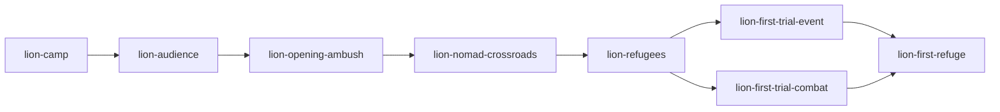
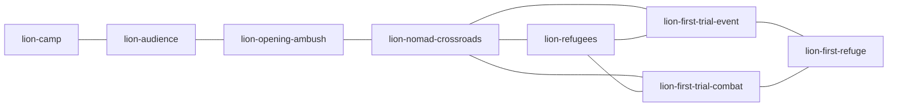

# POI V2 and physical-engine retirement

| Field | Value |
| --- | --- |
| TASK | POI-V2-AND-TRAVERSAL-RETIREMENT |
| DOMAIN | Campaign / UI / compatibility / retirement |
| BASELINE | dev@b79063bb4d96636198e93d61b7b3dd1110dab6e2 |
| BRANCH | dev |
| HEAD | See coherent delivery commits in Git; no self-reference |
| STATUS | IN_PROGRESS |
| MERGED_IN | NONE; direct authorized dev checkpoints |
| SUPERSEDES | NONE; older scoped proofs remain historical |
| SUPERSEDED_BY | NONE |
| PRODUCTION_IMPACT | Pending A/B/C/D implementation |
| CANONICAL_DOCS_UPDATED | Operator ledger and reviewed contract set1.3.0 |
| EVIDENCE | Pending current native proof; no runtime/art PASS |

## Approved decision and contract gate

OD-2026-10-15-A authorizes the exceptional manual mission. Both full operator attachments are preserved in docs/autonomy. Independent `contracts-guardian` actual-diff review PASS on2026-10-15: six changed contracts, README/manifest1.3.0; constitution, media and combat contracts unchanged. Corrections ensure map selection alone grants no completion and trial bypass cannot open first refuge. Validator8contracts/8slots and diff-check PASS. Amendment is a decision, not runtime acceptance. All twelve compliance rows PASS for amendment scope only; runtime, V6, art and retirement remain pending.

## First-phase topology

CURRENT FACT at starting HEAD: directed recovery graph:

The initial map adds crossroads→trial connections only after an explicit refugee bypass. V2 authorizes these as actual local geography once the mandatory crossroads is resolved, retaining the directed recovery graph:

Required facts: audience, actual opening victory, resolved nomad encounter, one actual exclusive trial. Refugee bypass is optional and once-only; skipped refugee remains revisitable. No new content IDs, chest, elite or reward placement is approved.
