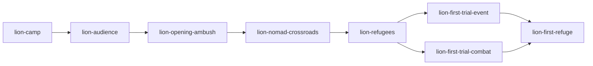
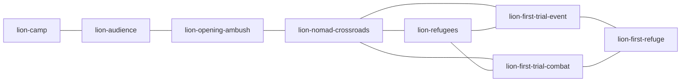

# POI V2 and physical-engine retirement

| Field | Value |
| --- | --- |
| TASK | POI-V2-AND-TRAVERSAL-RETIREMENT |
| DOMAIN | Campaign / UI / compatibility / retirement |
| BASELINE | dev@b79063bb4d96636198e93d61b7b3dd1110dab6e2 |
| BRANCH | dev |
| HEAD | See coherent delivery commits in Git; no self-reference |
| STATUS | IN_PROGRESS |
| MERGED_IN | NONE; direct authorized dev checkpoints |
| SUPERSEDES | NONE; older scoped proofs remain historical |
| SUPERSEDED_BY | NONE |
| PRODUCTION_IMPACT | A branching, B explicit regions, C illustrated atlas, D physical-engine retirement implemented; current native acceptance pending |
| CANONICAL_DOCS_UPDATED | Operator ledger, contract set1.3.0, POI_NAVIGATION, art/authoring and retirement inventory |
| EVIDENCE | Reviewed A native proof; current C/D native proof pending |

## Approved decision and contract gate

OD-2026-10-15-A authorizes the exceptional manual mission. Both full operator attachments are preserved in docs/autonomy. Independent `contracts-guardian` actual-diff review PASS on2026-10-15: six changed contracts, README/manifest1.3.0; constitution, media and combat contracts unchanged. Corrections ensure map selection alone grants no completion and trial bypass cannot open first refuge. Validator8contracts/8slots and diff-check PASS. Amendment is a decision, not runtime acceptance. All twelve compliance rows PASS for amendment scope only; runtime, V6, art and retirement remain pending.

## First-phase topology

CURRENT FACT at starting HEAD: directed recovery graph:

The initial map adds crossroads→trial connections only after an explicit refugee bypass. V2 authorizes these as actual local geography once the mandatory crossroads is resolved, retaining the directed recovery graph:

Required facts: audience, actual opening victory, resolved nomad encounter, one actual exclusive trial. Refugee bypass is optional and once-only; skipped refugee remains revisitable. No new content IDs, chest, elite or reward placement is approved.

## Lot A implementation and first native finding

Product checkpoint `ca78057` published normally to origin/dev. RunSystem adds two authored local connections after all three mandatory corridor facts; all three outgoing contents are reachable at the crossroads. Direct trial selection applies the existing refugee-ignore consequence once through RunSystem. Required trials no longer expose bypass; actual resolution gates refuge. Old earned refuge flags/resolution preserve progression. Directed recovery graph,21IDs and V6 schema remain intact. Mechanical36current focused tests/types/build/contracts PASS; independent source/assertion review PASS.

Fresh native `poi-v2-first-refuge-0752` on5440: actual opening victory2rounds19actions and nomad dialogue, then **FAILED/NOT_ACCEPTED** at unchanged exact backtracking assertion. Result digest `fcfa4c03daa4b7e477c2e8920125687fcc7def6528539722f5d83acdd27bec5e`; provenance stable; no injection. Newly exposed unvisited trials initially received mandate-specific hints, but ID-only rematching replaced those hints on the next selector. Content IDs/resources/outcomes did not change; full saved-node stability still failed. The failed job is retained and unseedable.

Correction preserves a fully materialized graph node whose durable assignment already matches its content ID. Differing legacy assignments retain the existing restoration path. New full-graph mandate/backtracking/exactV6 regression plus57other focused tests pass; build PASS. Independent guardian correction review PASS. The native assertion is unchanged; fresh native rerun pending.

Fresh0810 **ACCEPTED_SCOPED_LOT_A_NATIVE_DESKTOP1366_NORMAL** on85b1889: actual opening victory3rounds17actions, authored Cédric choice, three reachable local routes, direct event selection, existing refugee37→35 once, trial initially unresolved then resolved, alternative neutralized/notresolved, refugee dialogue revisit, first-refuge services and exact full V6 reload. No errors/injection/mutation. Independent guardian verified raw result/receipt/9build files/driver/helper and three captures; all provenance/request/digest/current-execution checks passed before later source edits. Result SHA `b1819c257dbbb94bf486bac60fad2855473a841dc06be983b48155684bb43004`. [Selected compact proof](poi-v2-retirement-2026-10-15/A-results.json); the three `A-` captures preserve pre-art geography and reusable refuge. Failed0752 stays unseedable. This accepts A desktop normal only, not new art, alternate combat fresh play, B/D, mobile, motion or full demo.

## Lot B phase composition

Explicit metadata classifies all21canonical IDs by primary/structuring/secondary role, required/optional/exclusive-alternative participation and region. Depth no longer selects map panels. Opening is a forest network, Bois-Clair a river-valley fork and the final phase a diagonal ruin/preparation approach. Existing directed links, causal encounters, recruit/witness choices, rescue/sacrifice, refuges and final preparation/judgement remain unchanged. No new node/content/reward is activated. New metadata tests verify exact canonical coverage and independent region/eligibility boundaries; current25focused tests pass. C integrates the matching atlas artwork and richer marker hierarchy next.

## Lot C implementation

Checkpoint6d4e1f9 integrates three new pixel-diorama region illustrations, generated and inspected against existing environment references. Code owns all connections, roles, status and actions. Native region tabs, spatial marker keyboard navigation, Locate, background dragging and native touch scrolling support browsing without changing game truth. Failed movement restores focus; hovering never rebuilds the action panel. Artwork manifests retain exact provenance/hashes and the candidate status for final operator artistic review. No video, canonical sprite or shared environment was replaced. Inactive chest/encounter authoring proposals are documented separately and activate no unapproved content.

## Lot D source milestone

The physical simulation is removed: all87tracked src/traversal files, its scene/controller/preview branches, three labs,21dedicated physical runners, two styles and their obsolete tests. GameApp coordinates the sole POI facade and existing narrative, combat, refuge, preparation and terminal owners. RunSystem removes physical Pursuit requests/results while retaining durable T0–T4, V6 traversalBranches, recovery/bypass facts, adaptive encounters and loot/checkpoint authority. SceneTransition and the shared HUD remain neutral UI owners. The optional consequence policy was rehomed before the old shim was removed.

The reviewed177row inventory has zero uncertain dispositions and covers all144deleted paths.22orphan physical PNGs are removed; seven images linked by immutable historical reports and their metadata stay at original paths. Five obsolete mixed QA scripts are frozen as plain text; the UI gallery remains active with its original source archived. Shared characters, environments, cinematics, Journey, NarrativeStage, CombatBridge and compatibility APIs stay intact. No production importer, QA selector or active executable driver can mount the old engine.

Independent guardian actual-source/assertion review finds no authority/schema blocker.200relevant tests pass, six additional historical V6 lifecycle fixtures preserve the entire saved state and choose the proper current owner;23focused POI/refuge-order tests pass. All19QA receipt tests pass through node:test. TypeScript/build, eight shipped MP4s, validator8/8 and immutable/working LOCKED/whitespace gates pass. Broader159Vitest-compatible suites exposed historical source/media audit failures; exact classification follows in final verification. No global suite PASS or native retirement acceptance is claimed at this checkpoint. Existing campaign-driver assertions for real combat, consequences, defeat and exact V6 remain; the added atlas case uses native tabs/focus/44px targets/scroll and exact owner equality.
